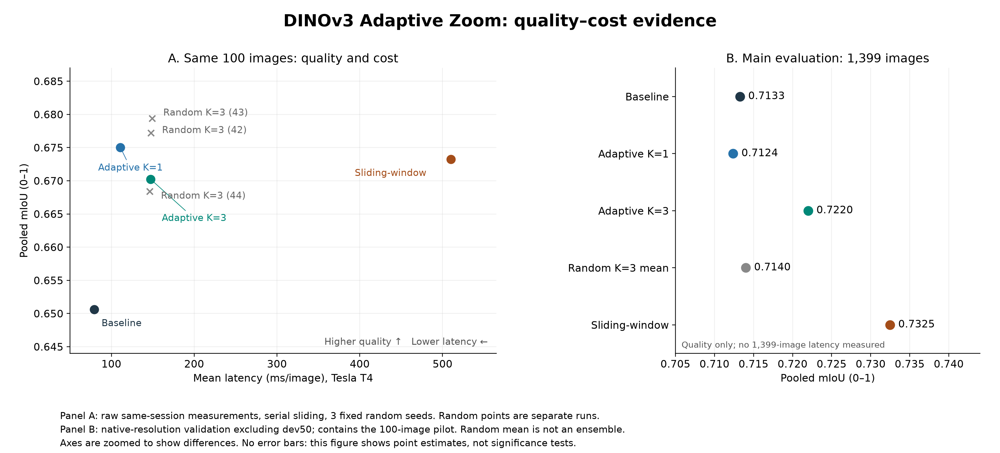

# Final konfigürasyon kararı

## Seçim

Final sistem gösterimi ve ana yöntem olarak **Adaptive K=3**, crop=112, stride=28, minimum entropy=0, kutu IoU=0,30, padding=0 seçildi. Fusion: crop dışında global logits, crop birleşimi içinde yerel logits, örtüşmelerde yerel logits ortalaması.

Bu seçim her veri grubunda veya her maliyet hedefinde optimum olduğu iddiası değildir. K=3, development seçeneklerinde yüksek mIoU ve büyük değerlendirmede aynı K'daki random'a karşı ölçülmüş katkı nedeniyle projenin temsilî konfigürasyonudur.

| İhtiyaç / karşılaştırma | Kanıt | Karar |
|---|---|---|
| En düşük ölçülmüş süre | Baseline 79,2 ms, 1 geçiş | Gecikme öncelikliyse baseline avantajlı. |
| Ana değerlendirmede en yüksek doğruluk | Sliding mIoU 0,7325; K=3 0,7220 | Doğruluk öncelikliyse seri sliding daha iyi sonuç verdi. |
| Aynı crop bütçesinde selector katkısı | 1.399 görüntüde K=3 − random K=3 ortalaması +0,80 puan, %95 GA [+0,29; +1,33] | Bu protokolde entropy seçiminin katkısı destekleniyor. |
| Baseline'a genel üstünlük | K=3 − baseline +0,87 puan, GA [−0,14; +1,96] | Kesin üstünlük iddia edilmez. |
| Sliding'e göre süre–kalite dengesi | K=3 147,5 ms, sliding 510,3 ms; süre oranı 3,46× [3,33; 3,62]. Ana kalite farkı −1,05 puan [−1,51; −0,58]. | Daha düşük süre karşılığında daha düşük doğruluk. Kalite ve süre örneklemleri farklıdır. |
| Aynı 100 görüntüde K seçimi | K=1: 0,6750 / 110,8 ms; K=3: 0,6702 / 147,5 ms | Bu pilotun nokta tahminlerinde K=1, K=3'ten hem daha hızlı hem daha doğru. K=3 evrensel en iyi trade-off değildir. |
| Aynı 100 görüntüde random K=3 | Üç seed ortalama mIoU yaklaşık 0,6750; adaptive K=3 0,6702. Süreler yaklaşık eşit. | Pilot ile 1.399 görüntülük sonuç birbirine karıştırılmaz. |
| Minimum entropy / overlap eşiği | 50 dev örneğinde reference 0,5807; denenen eşik değişiklikleri daha düşük mIoU verdi. | Final eşikler korunur; küresel optimum iddia edilmez. |

## Ölçüm kapsamı

Kalite: 1.399 görüntü, native çözünürlük, ignore=255, background dahil, pooled confusion üzerinden mIoU. Süre: aynı 100 görüntüde, aynı Tesla T4 oturumunda; warm-up ve CUDA synchronization kullanılmış seri uygulama. Bu 100 görüntü ana 1.399 içinde bulunur. Random üç sabit seed ortalaması ensemble değildir. Geçiş sayısı FLOPs değildir, relative cost ölçülen süre oranıdır.

K=3 dört model geçişi kullanır, baseline'a göre yaklaşık 1,86× süre harcar. Ana kalite nokta tahmini yaklaşık +0,87 puan artsa da güven aralığı sıfırı içerir. Bu nedenle ek compute maliyetinin her görüntüde veya her veri grubunda kazanca dönüşeceği söylenmez.

## Grafik

Panel A'nın iki ekseni de aynı 100 görüntüden gelir. Panel B'de yalnızca 1.399 görüntülük kalite gösterilir. Noktalar tahmin değerleridir; grafik tek başına istatistiksel anlamlılık göstermez. Random seed varyasyonu görüntü bootstrap güven aralığıyla aynı şey değildir.

Kaynaklar: `benchmark_all_k3_100_20261007T194714_806084Z (1).zip` içindeki protocol/results/measurements kayıtları; `Reproducibility/metrics_verification.json`; `Docs/DINOv3_Final_Deney_Raporu_TR.md`. Grafik veri ve kaynak hash'leri `Quality_Cost/figure_data.json` içinde saklanır.
