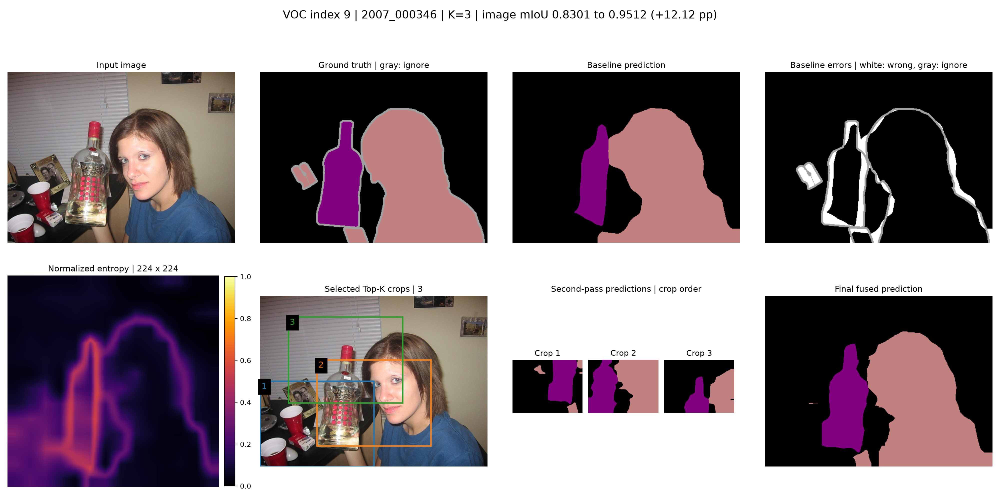
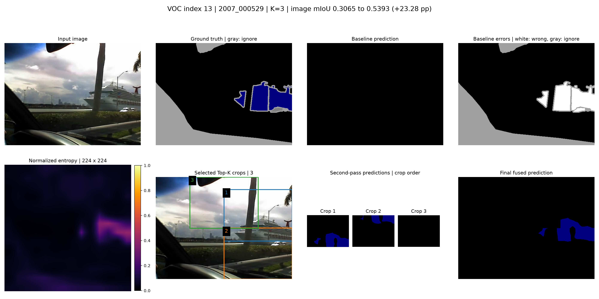
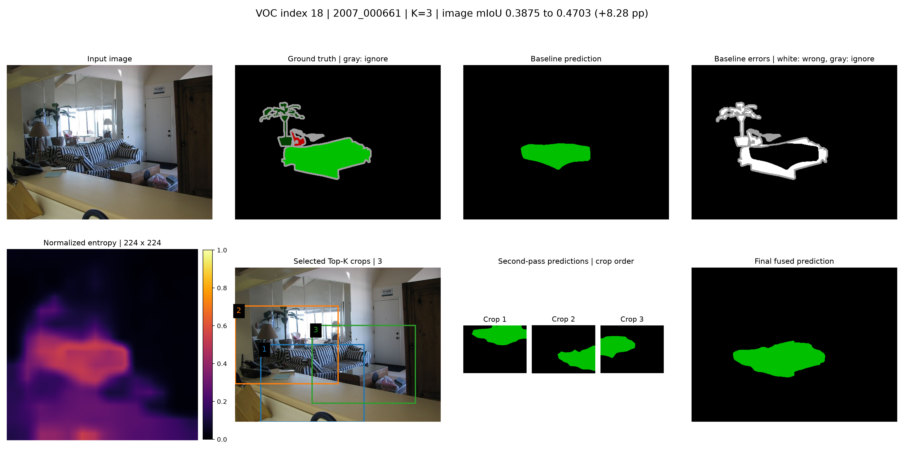
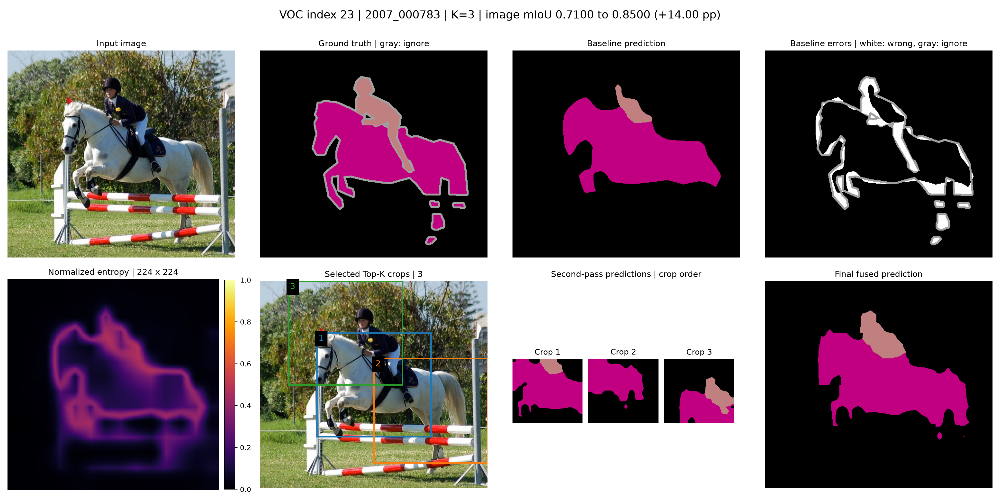
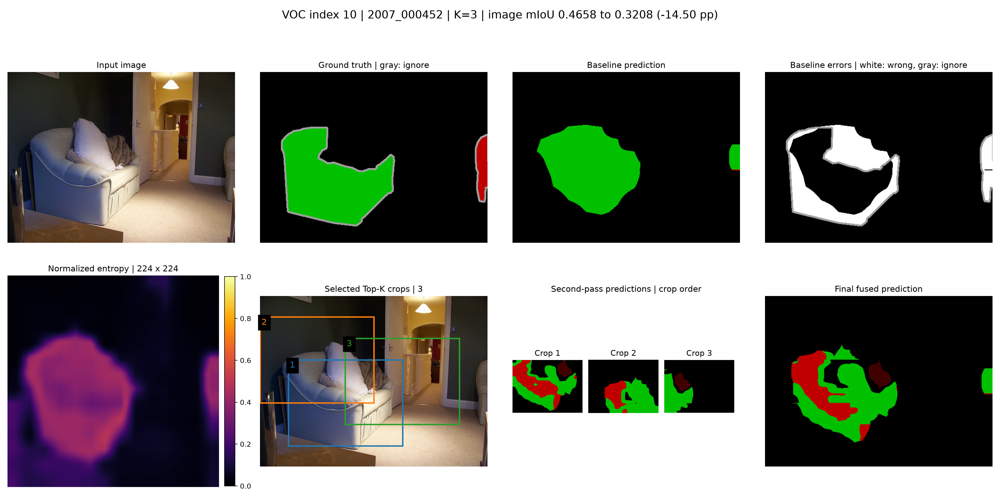
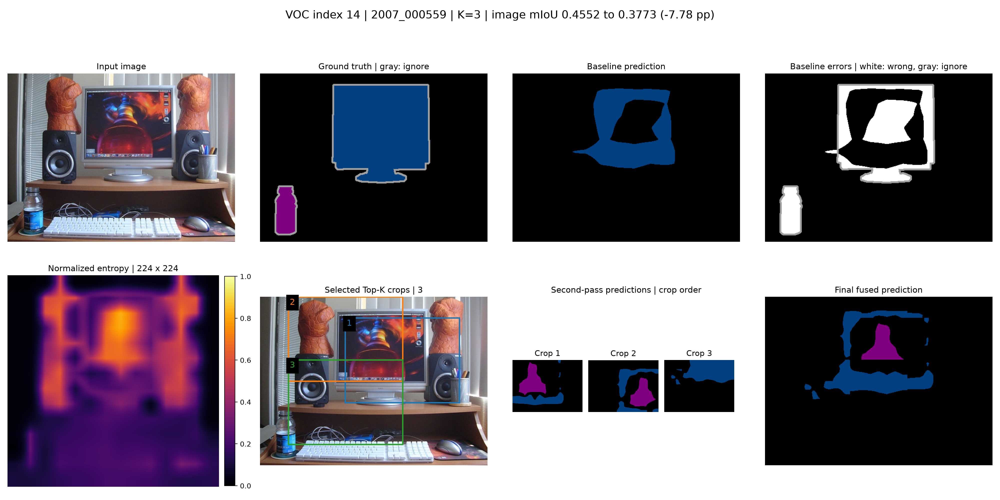

# Final görsel seçimi ve kapsamı

Dört başarı ve iki failure örneği development grubundan amaçlı seçildi; bağımsız test veya ortalama başarı kanıtı değildir.

Sekiz panel: input, GT, baseline, baseline error map, normalize entropy, Top-K kutuları, second-pass çıktıları ve final fusion. Error map beyaz=geçerli hatalı piksel, siyah=doğru, gri=ignore=255.

| Index | Görüntü ID | Tür | Baseline | K=3 | Fark (puan) | Durum |
|---|---|---|---:|---:|---:|---|
| 9 | 2007_000346 | success | 0.8301 | 0.9512 | +12.12 | Görsel hazır |
| 13 | 2007_000529 | success | 0.3065 | 0.5393 | +23.28 | Görsel hazır |
| 18 | 2007_000661 | success | 0.3875 | 0.4703 | +8.28 | Görsel hazır |
| 23 | 2007_000783 | success | 0.7100 | 0.8500 | +14.00 | Görsel hazır |
| 10 | 2007_000452 | failure | 0.4658 | 0.3208 | -14.50 | Görsel hazır |
| 14 | 2007_000559 | failure | 0.4552 | 0.3773 | -7.78 | Görsel hazır |

Oracle–Adaptive görseli index 9 için K=1 entropy kutusu ve önceki galeride kayıtlı GT hedef kutusunu gösterir. Oracle GT kullanır ve crop alanı farklıdır; eş bütçeli doğruluk kıyası veya üst sınır iddiası değildir.

9 ve 10'un ham çıktıları temiz Colab testinden yeniden kullanıldı. Eksik dört örnek aynı oturumda ayrıca işlendi. Altı örneğin skorları PNG maskelerinden yeniden hesaplandı; checkpoint/config, ZIP CRC, crop koordinatları ve crop dışının korunması kontrol edildi. Kaynaklar ve hash'ler selection_manifest.json içinde.

## Tez için şekil açıklamaları

### Index 9 — 2007_000346

Şişe ve kişi içeren sahnede seçilen üç bölgeyle görüntü mIoU artmıştır. Nesne sınırlarında iyileşme görülebilir; bu tek örnek sınıf genelinde üstünlük kanıtı değildir.

Native image mIoU: 0.8301 → 0.9512; fark +12.12 yüzde puan. K=3, toplam dört geçiş. Ignore=255 gri gösterilir.

### Index 13 — 2007_000529

Tekne sahnesinde baseline ve K=3 çıktıları karşılaştırılır. Hedef sınıfı tekne olan bu development örneğinde görüntü mIoU artmıştır; kazanç yalnızca küçük nesnelere atfedilmez.

Native image mIoU: 0.3065 → 0.5393; fark +23.28 yüzde puan. K=3, toplam dört geçiş. Ignore=255 gri gösterilir.

### Index 18 — 2007_000661

Bitki hedefi içeren iç mekân sahnesinde K=3 sonucu baseline'a göre daha yüksek görüntü mIoU vermiştir. Şekil sınıf veya nesne boyutu bazında genel başarı iddiası taşımaz.

Native image mIoU: 0.3875 → 0.4703; fark +8.28 yüzde puan. K=3, toplam dört geçiş. Ignore=255 gri gösterilir.

### Index 23 — 2007_000783

At ve binici içeren sahnede global tahmin, entropy seçimi ve yerel tahminler gösterilir. Fusion sonrasında görüntü mIoU yükselmiştir.

Native image mIoU: 0.7100 → 0.8500; fark +14.00 yüzde puan. K=3, toplam dört geçiş. Ignore=255 gri gösterilir.

### Index 10 — 2007_000452

Yüksek entropy'li sofa alanına yönelen crop'lar, yerel tahminde sınıf parçalanması üretmiştir. Görüntüde kedi görünmesine rağmen geçerli GT'de cat sınıfı bulunmadığından ilgili tahmin yanlış pozitif olarak değerlendirilir. Ölçek/bağlam etkisi olasıdır, bu şekille nedensel olarak ayrıştırılmaz.

Native image mIoU: 0.4658 → 0.3208; fark -14.50 yüzde puan. K=3, toplam dört geçiş. Ignore=255 gri gösterilir.

### Index 14 — 2007_000559

Monitör içeriği ve sahnedeki nesne sınıfları arasındaki karışıklık, yerel tahminin fusion ile aktarılmasından sonra görüntü mIoU kaybına eşlik eder. Gerçek GT şişesinin seçilmesi garanti değildir; değerlendirme GT anotasyonuna göre yapılır.

Native image mIoU: 0.4552 → 0.3773; fark -7.78 yüzde puan. K=3, toplam dört geçiş. Ignore=255 gri gösterilir.

