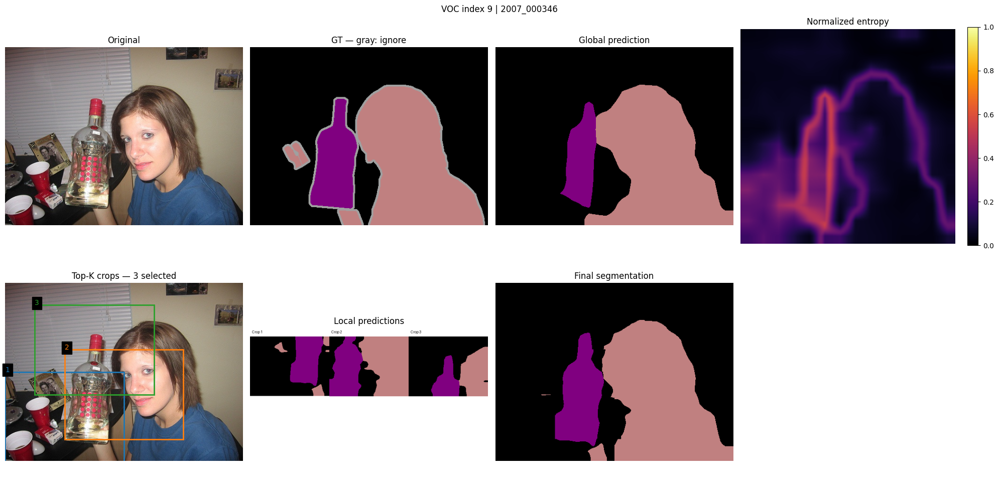
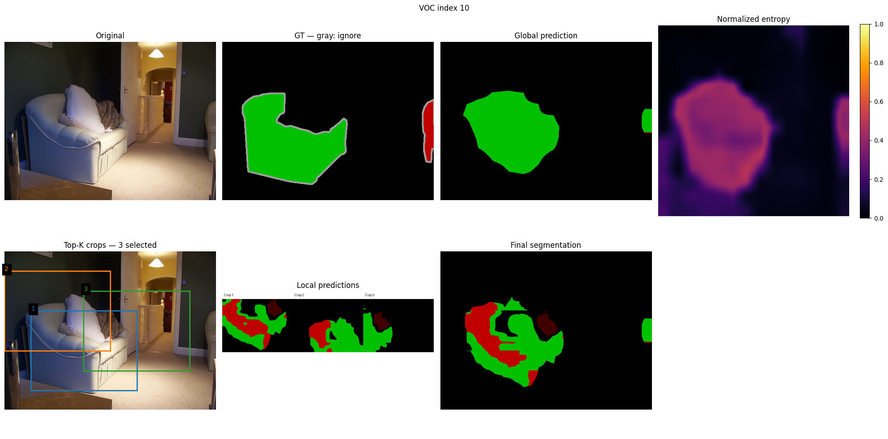

# DINOv3 tabanlı semantik segmentasyonda belirsizlik ile uyarlanabilir bölge işleme

Türkçe tez bölüm taslağı — 8 Ekim 2026. Üniversite şablonuna aktarılmadan önce bölüm numaraları, başlık, kaynakça biçimi ve sayfa düzeni uyarlanmalıdır. Metin tamamlanmış deneylerden hazırlanmıştır; yeni deney veya tam literatür taraması içermez.

## 1. Problem ve araştırma amacı

Semantik segmentasyonda amaç, görüntünün her pikselini bir sınıfa atamaktır. Bir görüntüyü düşük çözünürlükte tek geçişle işlemek, ince sınırların ve küçük yapıların temsiline sınırlı alan bırakır. Görüntünün tamamını çok sayıda yakınlaştırılmış crop ile işlemek ise daha fazla model geçişi gerektirir. Bu çalışmada, ikinci işlem aşamasını yalnızca modelin belirsizlik gösterdiği bölgelere yönlendiren bir yaklaşım incelenmiştir.

Araştırma sorusu şu şekilde tanımlanmıştır: **Global tahminden elde edilen entropy ile seçilen sınırlı sayıdaki crop, aynı bütçeli rastgele seçime göre daha yararlı bölgeler işleyebilir ve yoğun sliding-window yöntemine göre uygun bir doğruluk–süre dengesi sağlayabilir mi?**

DINOv3, kendinden gözetimli öğrenmeyle geliştirilen bir görsel temsil modelidir ve yoğun görsel özelliklerin farklı görevlere aktarımını ele alır. Bu çalışmada DINOv3'ün özellikleri segmentation head için kullanılmış; backbone yeniden eğitilmemiştir. Çalışmanın katkısı yeni bir DINOv3 ön eğitimi değil, mevcut özelliklerle global tahmin, bölge seçimi, ikinci inference ve fusion aşamalarının değerlendirilmesidir. [DINOv3 teknik raporu](https://arxiv.org/abs/2508.10104).

## 2. Yöntem

### 2.1. Backbone ve segmentation head

Özellik çıkarıcı olarak `facebook/dinov3-vits16-pretrain-lvd1689m` kullanılmıştır. Sabitlenen model revision'ı `114c1379950215c8b35dfcd4e90a5c251dde0d32`'dir. Kullanılan backbone, 384 boyutlu patch özelliklerine, 16 piksel patch boyutuna ve dört register token'a sahiptir. CLS ve register token'lar çıkarılarak 224×224 giriş için kalan 14×14 patch grid'i iki boyutlu özellik haritasına dönüştürülmüştür.

Bu özellik haritasına 21 çıkış kanallı 1×1 convolution uygulanmıştır. Head logits'i bilinear interpolation ile 224×224'e taşınmıştır. VOC2012 train grubundaki 1.464 görüntüyle beş epoch boyunca yalnızca head eğitilmiş; backbone dondurulmuş ve eval modunda tutulmuştur. Sonraki deneyler aynı head checkpoint'i geri yüklenerek gerçekleştirilmiş, yeniden eğitim yapılmamıştır. Dolayısıyla DINOv3 ön eğitimi kendinden gözetimli olsa da bu çalışmadaki segmentation head gözetimli eğitim kullanmıştır.

### 2.2. Global inference ve entropy haritası

Orijinal RGB görüntü bicubic interpolation ile 224×224'e boyutlandırılmış ve model processor'ının mean/std değerleriyle normalize edilmiştir. Tek global inference ile elde edilen logits'e sınıf ekseninde softmax uygulanmıştır. Bir konumdaki normalize entropy aşağıdaki şekilde hesaplanmıştır:

$$H(x) = -\frac{1}{\log C}\sum_{c=1}^{C}p_c(x)\log p_c(x),\qquad C=21.$$

Logaritmanın sayısal kararlılığı için olasılıklar en az $10^{-12}$ olarak sınırlandırılmıştır. Entropy bir seçim sinyalidir; yüksek entropy'nin mutlaka hata anlamına geldiği veya düşük entropy'nin doğruluğu garanti ettiği varsayılmamıştır.

### 2.3. Aday crop'lar ve Top-K seçimi

224×224 entropy haritasında varsayılan 112×112 pencere, 28 piksel stride ile kaydırılmış ve 25 aday üretilmiştir. Her adayın skoru, kapsadığı entropy değerlerinin ortalamasıdır:

$$s(R)=\frac{1}{|R|}\sum_{x\in R}H(x).$$

Adaylar skorlarına göre azalan sırada değerlendirilmiştir. Greedy seçim sırasında yeni kutunun daha önce seçilmiş her kutuyla IoU değerinin eşik altında kalması şartı uygulanmıştır. Varsayılan IoU eşiği 0,30 ve maksimum crop sayısı K=3'tür. Bu NMS benzeri filtre, kutuları tamamen ayrık hale getirmez; farklı nesnelerin seçilmesini de garanti etmez.

Minimum entropy eşiği, piksel haritasını eşiklemek yerine aday crop'un ortalama skoruna uygulanmıştır. Varsayılan minimum entropy 0'dır. Eşik veya overlap kısıtı nedeniyle seçilen crop sayısı K'dan az olabilir. Hiç aday seçilmezse final tahmin baseline olarak bırakılmıştır. Selector'a inference sırasında GT verilmemiştir.

### 2.4. Orijinal koordinatlara dönüş ve second pass

Seçilen kutular entropy haritasından orijinal görüntü koordinatlarına ölçeklenmiştir. Başlangıç koordinatlarına floor, bitiş koordinatlarına ceil uygulanmış ve görüntü sınırları kontrol edilmiştir. Crop'lar düşük çözünürlüklü görüntüden değil, orijinal RGB görüntüden alınmıştır.

Her crop 224×224'e dönüştürülerek aynı backbone ve head ile yeniden işlenmiştir. Yerel logits, crop'un orijinal boyutuna bilinear interpolation ile geri taşınmıştır. K=1, K=3 ve K=5 için koordinat dönüşümü, crop sayısı ve ikinci inference entegrasyonu kontrol edilmiştir. Varsayılan akışta padding kullanılmamıştır.

### 2.5. Çoklu fusion

Crop birleşimi dışında global logits korunmuştur. Yalnızca bir crop'un kapsadığı konumlarda yerel logits doğrudan kullanılmış; birden fazla crop'un kapsadığı konumlarda yerel logits'in aritmetik ortalaması alınmıştır. Yerel ve global logits bu varsayılan fusion içinde birlikte ortalanmamıştır.

Global logits $L_g(x)$, konumu kapsayan crop kümesi $\mathcal{R}(x)$ ve yerel logits $L_r(x)$ ile final logits:

$$L_f(x)=\begin{cases}
\frac{1}{|\mathcal{R}(x)|}\sum_{r\in\mathcal{R}(x)}L_r(x), & |\mathcal{R}(x)|>0,\\
L_g(x), & |\mathcal{R}(x)|=0.
\end{cases}$$

Final sınıf, bu logits üzerinde argmax ile belirlenmiştir. Crop birleşimi dışındaki logits'in global logits ile aynı kaldığı ayrıca kontrol edilmiştir. Yerel logits, prediction ve koordinatlar kaydedilmiş; yeniden yüklenen çıktılarla aynı K=5 final prediction elde edilmiştir.

### 2.6. Karşılaştırma yöntemleri

Baseline tek global inference kullanır. Adaptive K=1 ve K=3 sırasıyla toplam iki ve dört backbone geçişi kullanır. Random K=3, aynı adaylar ve overlap kısıtı üzerinden üç crop seçer; adaptive ile aynı fusion ve dört geçiş bütçesine sahiptir. Üç ayrı random seed (42, 43, 44) değerlendirilmiştir. Random mean, ayrı seed sonuçlarının ortalamasıdır; bir prediction ensemble'ı değildir.

Sliding-window, tüm 25 crop'u sıralı işler ve örtüşen yerel logits'i ortalar. Bu uygulama global inference yapmaz. Batch halinde optimize edilmiş sliding sürümü bu çalışmanın karşılaştırmasına dahil değildir.

## 3. Deneysel düzen

### 3.1. Veri ve örneklem ayrımı

VOC2012 segmentation görevi 20 nesne sınıfı ve background içerir. Bu çalışmada 21 sınıf değerlendirilmiştir. [VOC2012 resmi development kit](https://www.robots.ox.ac.uk/~vgg/projects/pascal/VOC/voc2012/htmldoc/index.html).

| Grup | Kullanım |
|---|---|
| Train: 1.464 görüntü | Segmentation head eğitimi |
| Development: 50 validation görüntüsü | Küçük hedef içeren GT seçimi; selector ve ablation çalışmaları |
| Pilot: 100 görüntü | Development ile çakışmayan doğruluk/süre pilotu |
| Büyük değerlendirme: 1.399 görüntü | Validation'ın development dışındaki tamamı |

Development grubu küçük hedeflere göre seçildiği için genel validation dağılımını temsil etmez. 100 pilot görüntüsü, 1.399 görüntülük gruba dahildir ve sonuçları önceden görülmüştür. Bu nedenle büyük değerlendirme, dokunulmamış bir test seti olarak tanımlanmamıştır.

### 3.2. Doğruluk ölçümü

224×224 logits orijinal görüntü boyutuna taşınmış ve native GT ile karşılaştırılmıştır. GT=255 pikselleri dışlanmış, background değerlendirmeye dahil edilmiştir. Sınıf IoU'su $TP/(TP+FP+FN)$ ile hesaplanmıştır; bu tanım VOC değerlendirmesiyle uyumludur. [VOC2012 değerlendirme tanımı](https://www.robots.ox.ac.uk/~vgg/projects/pascal/VOC/voc2012/htmldoc/index.html).

Ana metrik pooled mIoU'dur: önce görüntülerin confusion matrix'leri toplanır, ardından sınıf IoU'ları ve sınıf ortalaması hesaplanır. Bu değer image mIoU ortalaması değildir. Image mIoU incelemelerinde union'u pozitif sınıflar kullanılmıştır; GT'de olmayan false-positive sınıflar da ortalamaya girebilir.

### 3.3. Süre ölçümü ve belirsizlik

Süre benchmark'ı Tesla T4 üzerinde aynı oturumdaki 100 görüntüde yapılmıştır. Warm-up uygulanmış, ölçüm öncesi/sonrası CUDA synchronization kullanılmış ve yöntemlerin görüntü başına çalışma sırası değiştirilmiştir. Yöntemler bağımsız inference yapmıştır. Preprocessing, model inference, CPU logits transferi, selector, resize, fusion ve argmax süreye dahildir. Görüntü decode, GT, metrik ve dosya kaydı süre dışında tutulmuştur.

Doğruluk farkları ve süre karşılaştırmaları için 5.000 paired image bootstrap örneklemesi uygulanmıştır. Aynı örneklenen görüntüler bütün yöntemler için birlikte kullanılmıştır. Süre oranları ortalama sürelerin oranıdır. Bu aralıklar görüntü örneklemesindeki belirsizliği gösterir; farklı GPU'lar, oturum tekrarları veya tüm random seed dağılımı için güven aralığı değildir.

## 4. Sonuçlar

### 4.1. Büyük doğruluk değerlendirmesi

| Yöntem | Pooled mIoU — 1.399 görüntü | Geçiş |
|---|---:|---:|
| Baseline | 0,7133 | 1 |
| Adaptive K=1 | 0,7124 | 2 |
| Adaptive K=3 | 0,7220 | 4 |
| Random K=3 mean | 0,7140 | Her seed için 4 |
| Sliding | 0,7325 | 25 |

| Fark | Yüzde puan | %95 bootstrap aralığı |
|---|---:|---|
| K=3 − baseline | +0,87 | [−0,14; +1,96] |
| K=3 − K=1 | +0,96 | [+0,35; +1,55] |
| K=3 − random K=3 mean | +0,80 | [+0,29; +1,33] |
| K=3 − sliding | −1,05 | [−1,51; −0,58] |

Bu sonuçlar kullanılan protokolde K=3'ün K=1 ve sabit üç random seed ortalamasına katkısını desteklemektedir. Baseline'a karşı aralık sıfırı içerdiğinden kesin üstünlük ileri sürülmemiştir. Sliding daha yüksek pooled mIoU vermiştir.

### 4.2. İşlem süresi

| Yöntem | Mean ms — 100 görüntü | Median ms | P95 ms |
|---|---:|---:|---:|
| Baseline | 79,2 | 65,5 | 127,6 |
| Adaptive K=1 | 110,8 | 98,3 | 171,4 |
| Adaptive K=3 | 147,5 | 133,0 | 216,5 |
| Random 42 K=3 | 147,7 | 132,8 | 224,2 |
| Random 43 K=3 | 149,2 | 133,5 | 220,4 |
| Random 44 K=3 | 146,4 | 134,3 | 222,6 |
| Sliding | 510,3 | 472,0 | 698,4 |

K=3 sliding'den 3,46 kat hızlıdır; %95 aralık [3,33; 3,62]. Süre azalması %71,10, aralığı [%69,95; %72,35]'tir. K=3 baseline'ın 1,86 katı süre kullanmıştır. Adaptive–random K=3 mean farkı −0,31 ms, aralığı [−4,51; +3,55] ms olduğundan belirgin süre farkı gösterilmemiştir.

Peak allocated GPU bellek bütün yöntemlerde 98,3 MB'dır. Bu ölçümde bellek avantajı bulunmamıştır; CPU ve reserved GPU bellek ölçülmemiştir. Ana doğruluk tablosu 1.399, süre tablosu 100 görüntüdür; bu farklı örneklem kapsamları birlikte belirtilmelidir.

### 4.3. Selector ve sınıf davranışı

50 development görüntüsünde adaptive K=1, baseline hata piksellerinin %45,87'sini kapsarken random üç seed ortalaması %28,90'ını kapsamıştır. Yaklaşık aynı geçerli alanla fark +16,97 yüzde puandır. Selector'ın daha fazla hata içeren bölgeleri seçmesi, second pass'in bu hataları düzelttiği anlamına gelmez.

1.399 görüntüde K=3, baseline'a karşı 10/21 ve random K=3 mean'e karşı 16/21 sınıfta daha yüksek IoU vermiştir. Baseline'a karşı bicycle +13,14 ve pottedplant +10,11 puan yükselirken bottle −6,30 ve cow −4,92 puan düşmüştür. Sınıf farkları betimseldir; sınıf bazlı güven aralıkları hesaplanmamıştır. Bu analiz küçük nesne boyut grupları için ayrı bir IoU değerlendirmesi değildir.

### 4.4. Threshold ablation

K en fazla 3 iken aynı 50 development görüntüsünde minimum crop entropy ve overlap eşiği ayrı ayrı değiştirilmiştir:

| Konfigürasyon | Pooled mIoU | Mean crop sayısı | Mean geçiş |
|---|---:|---:|---:|
| Reference: entropy=0, IoU=0,30 | 0,5807 | 3,00 | 4,00 |
| Minimum entropy=0,10 | 0,5712 | 2,74 | 3,74 |
| Minimum entropy=0,20 | 0,5140 | 1,40 | 2,40 |
| Minimum entropy=0,30 | 0,4718 | 0,32 | 1,32 |
| IoU eşiği=0,10 | 0,5796 | 2,50 | 3,50 |
| IoU eşiği=0,50 | 0,5700 | 3,00 | 4,00 |

Mevcut konfigürasyon denenen seçenekler arasında en yüksek development mIoU'yu korumuştur. Daha yüksek entropy eşikleri işlem bütçesini azaltmış, doğruluğu da düşürmüştür. IoU=0,10 seçeneği daha az ortalama geçişle benzer bir nokta tahmini vermiştir; doğruluk eşdeğerliği veya süre avantajı ölçülmemiştir. Crop inference cache'i kullanıldığı için bu ablation bir latency benchmark'ı değildir.

### 4.5. Başarı ve failure örnekleri

**Şekil 1.** Başarılı bir örnekte baseline image mIoU 0,8301'den K=3 ile 0,9512'ye yükselmiştir. Görselde orijinal görüntü, GT, global prediction, entropy, seçilen kutular, yerel tahminler ve final mask gösterilmektedir. Bu örnek tek görüntülük açıklayıcı bir gösterimdir.

**Şekil 2.** Failure örneğinde image mIoU 0,4658'den 0,3208'e düşmüştür. Kutular sofa çevresinde kümelenmiş ve yerel tahminlerin fusion'ı sınıf parçalanmasına yol açmıştır. Crop sınırları dışındaki iç bölgelerde de hatalar görülmüştür. Bağlam kaybı ve ölçek değişimi olası açıklamalardır; bu nedenler ayrı nedensel deneylerle izole edilmemiştir.

Özel JPG upload akışı da bir illüstrasyon üzerinde çalıştırılmış; K=3 ve dört geçişle görsel ve sonuç paketi üretilmiştir. GT olmadığı için doğruluk metrikleri hesaplanmamıştır. Bu gösterim, akışın kullanıcı görüntüsü kabul ettiğini doğrular; gerçek fotoğraflarda genel başarı veya doğruluk artışı kanıtı değildir.

## 5. Tartışma ve sınırlamalar

Deneyler, region selector'ın katkısını aynı K ve fusion kullanan random seçimle ölçmeye olanak vermiştir. K=1 büyük değerlendirmede baseline veya random'a belirgin bir katkı göstermemiştir; K=3'te random mean'e karşı pozitif fark bulunmuştur. Crop sayısını artırmak bazı seçimi kaçırılmış bölgeleri kapsayabilmektedir; ancak aynı belirsiz alanı tekrar işleme, nesneyi crop sınırında kesme ve bağlam kaybı sorunları devam etmektedir.

Oracle zoom development grubunda mIoU'yu 0,4883'ten 0,6180'a çıkarmıştır. Oracle GT hedef kutusu kullandığı ve crop alanı farklı olduğu için uygulanabilir selector, eşit alanlı kıyas veya sıkı bir performans üst sınırı olarak sunulmamıştır. Ayrıca development grubunun küçük hedef seçimine dayanması, bu iyileşmenin genel validation sonucuna doğrudan genellenmesini engeller.

Pilot ve büyük değerlendirme sonuçları farklı davranış göstermiştir. Aynı 100 pilot görüntüsünde adaptive K=3 mIoU 0,6702, random mean yaklaşık 0,6750 iken 1.399 görüntüde adaptive daha yüksektir. Bu durum, yalnızca iyi görünen bir alt gruba veya görsele dayanarak genel başarı iddiası kurulmaması gerektiğini göstermektedir.

Çalışmanın başlıca sınırları, üç sabit random seed, tek GPU/oturum süre ölçümü, sıralı sliding uygulaması ve önceden görülmüş validation örnekleridir. Backbone/head eğitim seed'leri üzerinde çoklu tekrar yapılmamıştır. Genel küçük/orta/büyük nesne IoU analizi, confidence fusion ve alternatif region score yöntemleri değerlendirilmemiştir. Sınıf ve threshold farkları için ayrı güven aralıkları hesaplanmamıştır.

## 6. Sonuç

Bu çalışmada görüntüden global tahmin, entropy, otomatik Top-K crop seçimi, second pass, native koordinat dönüşümü ve çoklu fusion'a uzanan çalışır bir akış oluşturulmuştur. K=3, 1.399 görüntüde aynı bütçeli random seçimin üç seed ortalamasından daha yüksek pooled mIoU sağlamıştır. Sliding-window daha yüksek doğruluk sunarken adaptive K=3 ölçülen uygulamada yaklaşık %71 daha az süre kullanmıştır.

Çalışmanın sonucu, her görüntüde iyileşme veya düşük bütçeyle sliding'e eşdeğer doğruluk değildir. Bulgular, belirsizlik tabanlı bölge seçiminin hangi koşullarda yararlı olduğunu ve seçilen bölgenin yeniden işlenmesinin hangi durumlarda yeni hatalar üretebildiğini birlikte göstermektedir.

## Kaynaklar ve deney kanıtı

1. Siméoni, O. ve diğerleri (2025). *DINOv3*. arXiv:2508.10104. [Makale](https://arxiv.org/abs/2508.10104), [resmi uygulama](https://github.com/facebookresearch/dinov3).
2. PASCAL VOC (2012). *VOC2012 Development Kit*, Segmentation Task ve Evaluation bölümleri. [Resmi dokümantasyon](https://www.robots.ox.ac.uk/~vgg/projects/pascal/VOC/voc2012/htmldoc/index.html).
3. Bu proje deney kayıtları: [birleştirilmiş deney raporu](DINOv3_Final_Deney_Raporu_TR.md). Nicel değerler kullanıcının paylaştığı Colab çıktılarıdır; bu tez taslağı hazırlanırken GPU inference tekrar çalıştırılmamıştır.

Şekiller kullanıcının paylaştığı demo ekran görüntülerinin değiştirilmeden kopyalanmış halidir. Nihai tez için doğrudan demo ZIP'indeki yüksek çözünürlüklü `demo_7_panels.png` tercih edilebilir; yerel prediction etiketleri final düzenlemede büyütülebilir.
