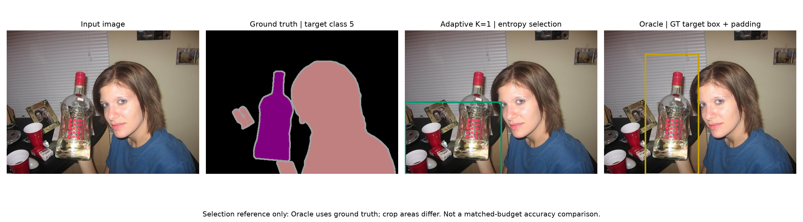

# DINOv3 tabanlı semantik segmentasyonda belirsizlik ile uyarlanabilir bölge işleme

Türkçe tez bölüm taslağı — güncelleme: 27 Ekim 2026. Region Selection, Adaptive Second Pass, Fusion ve Experimental Setup bölümleri kod, final config, split listeleri ve doğrulama kayıtlarıyla tamamlanmıştır. Benchmark, Ablation Study ve Computational Cost bölümleri final tabloları, kalite–maliyet grafiği ve süre oranlarıyla genişletilmiştir. Baseline, Oracle Zoom ve uncertainty sonuçları da kapsamlarıyla ayrılmıştır. Üniversite şablonuna aktarılmadan önce bölüm numaraları, başlık, kaynakça biçimi ve sayfa düzeni uyarlanmalıdır. Bu dosya bitmiş tezin tamamı veya tam literatür taraması değildir; yeni büyük deney içermez.

## 1. Problem ve araştırma amacı

Semantik segmentasyonda amaç, görüntünün her pikselini bir sınıfa atamaktır. Bir görüntüyü düşük çözünürlükte tek geçişle işlemek, ince sınırların ve küçük yapıların temsiline sınırlı alan bırakır. Görüntünün tamamını çok sayıda yakınlaştırılmış crop ile işlemek ise daha fazla model geçişi gerektirir. Bu çalışmada, ikinci işlem aşamasını yalnızca modelin belirsizlik gösterdiği bölgelere yönlendiren bir yaklaşım incelenmiştir.

Araştırma sorusu şu şekilde tanımlanmıştır: **Global tahminden elde edilen entropy ile seçilen sınırlı sayıdaki crop, aynı bütçeli rastgele seçime göre daha yararlı bölgeler işleyebilir ve yoğun sliding-window yöntemine göre uygun bir doğruluk–süre dengesi sağlayabilir mi?**

DINOv3, kendinden gözetimli öğrenmeyle geliştirilen bir görsel temsil modelidir ve yoğun görsel özelliklerin farklı görevlere aktarımını ele alır. Bu çalışmada DINOv3'ün özellikleri segmentation head için kullanılmış; backbone yeniden eğitilmemiştir. Çalışmanın katkısı yeni bir DINOv3 ön eğitimi değil, mevcut özelliklerle global tahmin, bölge seçimi, ikinci inference ve fusion aşamalarının değerlendirilmesidir. [DINOv3 teknik raporu](https://arxiv.org/abs/2508.10104).

## 2. Yöntem

### 2.1. Backbone ve segmentation head

Özellik çıkarıcı olarak `facebook/dinov3-vits16-pretrain-lvd1689m` kullanılmıştır. Sabitlenen model revision'ı `114c1379950215c8b35dfcd4e90a5c251dde0d32`'dir. Kullanılan backbone, 384 boyutlu patch özelliklerine, 16 piksel patch boyutuna ve dört register token'a sahiptir. CLS ve register token'lar çıkarılarak 224×224 giriş için kalan 14×14 patch grid'i iki boyutlu özellik haritasına dönüştürülmüştür.

Bu özellik haritasına 21 çıkış kanallı 1×1 convolution uygulanmıştır. Head logits'i bilinear interpolation ile 224×224'e taşınmıştır. VOC2012 train grubundaki 1.464 görüntüyle beş epoch boyunca yalnızca head eğitilmiş; backbone dondurulmuş ve eval modunda tutulmuştur. Sonraki deneyler aynı head checkpoint'i geri yüklenerek gerçekleştirilmiş, yeniden eğitim yapılmamıştır. Dolayısıyla DINOv3 ön eğitimi kendinden gözetimli olsa da bu çalışmadaki segmentation head gözetimli eğitim kullanmıştır.

### 2.2. Global inference ve entropy haritası

Orijinal RGB görüntü bicubic interpolation ile 224×224'e boyutlandırılmış ve model processor'ının mean/std değerleriyle normalize edilmiştir. Tek global inference ile elde edilen logits'e sınıf ekseninde softmax uygulanmıştır. Bir konumdaki normalize entropy aşağıdaki şekilde hesaplanmıştır:

$$H(x) = -\frac{1}{\log C}\sum_{c=1}^{C}p_c(x)\log p_c(x),\qquad C=21.$$

Logaritmanın sayısal kararlılığı için olasılıklar en az $10^{-12}$ olarak sınırlandırılmıştır. Entropy bir seçim sinyalidir; yüksek entropy'nin mutlaka hata anlamına geldiği veya düşük entropy'nin doğruluğu garanti ettiği varsayılmamıştır.

### 2.3. Aday crop'lar ve Top-K seçimi

224×224 entropy haritasında varsayılan 112×112 pencere, 28 piksel stride ile kaydırılmış ve 25 aday üretilmiştir. Her adayın skoru, kapsadığı entropy değerlerinin ortalamasıdır:

$$s(R)=\frac{1}{|R|}\sum_{x\in R}H(x).$$

Adaylar skorlarına göre azalan sırada değerlendirilmiştir. Tarama önce y, sonra x koordinatı boyunca yapılır; eşit skorlarda kararlı sıralama bu aday sırasını korur. Varsayılan durumda her eksendeki başlangıçlar 0, 28, 56, 84 ve 112'dir. Genel tarama yordamı, stride son sınırı tam kapsamıyorsa son geçerli başlangıcı ayrıca ekler. Boyutlar entropy haritasındaki piksel birimindedir; patch sayısı veya orijinal görüntü pikseli değildir.

Greedy seçimde adayın ortalama entropy'si en az minimum eşiğe eşit olmalı ve önceden seçilmiş her kutuyla IoU değeri eşikten küçük veya eşit kalmalıdır. Kutu kümesi $S$ için kabul koşulu:

$$s(R)\geq\tau_H\quad\text{ve}\quad\forall Q\in S:\ \frac{|R\cap Q|}{|R\cup Q|}\leq\tau_{IoU}.$$

Varsayılan IoU eşiği 0,30 ve maksimum crop sayısı K=3'tür. Kutu IoU'su 224×224 entropy koordinatlarında hesaplanır; segmentation mIoU ile karıştırılmaz. Yuvarlanmış native kutular üzerinde aynı eşik yeniden uygulanmaz. Bu NMS benzeri filtre, kutuları tamamen ayrık hale getirmez; farklı nesnelerin seçilmesini de garanti etmez.

Minimum entropy eşiği, piksel haritasını eşiklemek yerine aday crop'un ortalama skoruna uygulanmıştır. Varsayılan minimum entropy 0'dır. Eşik veya overlap kısıtı nedeniyle seçilen crop sayısı K'dan az olabilir. Hiç aday seçilmezse final tahmin baseline olarak bırakılmıştır. Selector'a inference sırasında GT verilmemiştir.

| Region Selection parametresi | Final değer | Anlamı |
|---|---|---|
| `k` | 3 | Seçilebilecek maksimum bölge sayısı |
| `crop_size` | 112 | Kare pencerenin 224×224 haritadaki kenarı |
| `stride` | 28 | Aday başlangıçları arasındaki harita piksel adımı |
| `minimum_entropy` | 0,0 | Adayın ortalama normalize entropy alt sınırı |
| `overlap_iou` | 0,30 | Seçilmiş her kutuyla izin verilen en büyük kutu IoU'su |
| `padding` | 0 | Orijinal görüntüde kutu genişletilmez |
| Aday skoru ve sıra | Ortalama entropy, azalan kararlı sıra | Rastgele seçim veya GT girdisi yok |

Algoritma, sıralı adayları dolaşır; koşulları sağlayanı seçilmiş listeye ekler ve K seçime ulaşıldığında durur. Seçim sayısı $K_{gerçek}$ ise model geçiş sayısı $1+K_{gerçek}$ olur. Final K=3 akışında üç crop seçildiğinde toplam dört geçiş yapılır; bu sayı ölçülmüş FLOPs veya süre oranı değildir.

### 2.4. Orijinal koordinatlara dönüş ve second pass

Orijinal RGB görüntünün genişliği $W$, yüksekliği $H$; entropy haritasının boyutu $W_e=H_e=224$ olsun. Seçilen kutu $b=(x_1,y_1,x_2,y_2)$, başlangıç dahil ve bitiş hariç koordinatları kullanır. Native başlangıçlar floor, bitişler ceil ile hesaplanır:

$$X_1=\max(0,\lfloor x_1W/W_e\rfloor),\quad X_2=\min(W,\lceil x_2W/W_e\rceil),$$
$$Y_1=\max(0,\lfloor y_1H/H_e\rfloor),\quad Y_2=\min(H,\lceil y_2H/H_e\rceil).$$

Kaynak kutunun harita sınırları içinde olduğu ve dönüşüm sonunda $0\leq X_1<X_2\leq W$, $0\leq Y_1<Y_2\leq H$ koşulları kontrol edilir. Böylece kutular görüntü dışına taşmaz ve boş crop üretilmez. Örneğin 500×375 görüntüde `(0,112,112,224)` harita kutusu `(0,187,250,375)` native kutusuna dönüşür; crop boyutu 250×188'dir. Kare harita penceresi, orijinal görüntünün en-boy oranı nedeniyle native koordinatlarda kare olmak zorunda değildir.

Crop, `image.crop((X1,Y1,X2,Y2))` ile orijinal RGB görüntüden alınır. Global görüntünün önceden 224×224'e küçültülmüş kopyasından kesilmez; böylece bölgedeki mevcut orijinal ayrıntı yeniden model girişine taşınır. Crop'un seçimi ve yeniden işlenmesi için GT'ye başvurulmaz.

Her crop 224×224'e dönüştürülerek aynı backbone ve head ile yeniden işlenmiştir. Yerel logits, crop'un orijinal boyutuna bilinear interpolation ile geri taşınmıştır. K=1, K=3 ve K=5 için koordinat dönüşümü, crop sayısı ve ikinci inference entegrasyonu kontrol edilmiştir. Varsayılan akışta padding kullanılmamıştır.

Global ve yerel girişlerde RGB dönüşümü, bicubic resize ve aynı processor mean/std normalizasyonu kullanılır. `to_tensor` ile piksel değerleri [0,1] aralığına getirilir; ardından her kanalda `(x−mean)/std` uygulanır. Checkpoint kaydındaki mean `(0,485, 0,456, 0,406)`, std `(0,229, 0,224, 0,225)` değerleri, sabit model revision'ına ait processor ile uygulanır. Model eval modunda ve inference gradient hesabı kapalı çalışır. Her crop aynı model ağırlıklarını kullanır; crop'a özel eğitim veya head güncellemesi yoktur.

Yerel çıktı `[1,21,224,224]` logits'tir. Önce logits, `(Y2−Y1, X2−X1)` native crop boyutuna `bilinear, align_corners=False` ile taşınır; sınıf argmax'ı fusion sonrasında alınır. Önceden argmax alınmış sınıf etiketleri bilinear interpolation ile büyütülmez. Yerel sonuç global tuvalde `[Y1:Y2, X1:X2]` dilimine yerleştirilir.

Çıktı paketlerinde her crop'un RGB görüntüsü, 224×224 logits'i, native sınıf prediction'ı, kutu koordinatları, rank ve entropy skoru saklanır. Böylece seçimin ve ikinci geçişin sonucu kayıtlı verilerden incelenebilir. Bu kayıtlar yeni inference çalıştırmakla aynı doğrulama düzeyi değildir; temiz oturum inference testi Bölüm 3.6'da ayrıca açıklanmıştır.

### 2.5. Çoklu fusion

Crop birleşimi dışında global logits korunmuştur. Yalnızca bir crop'un kapsadığı konumlarda yerel logits doğrudan kullanılmış; birden fazla crop'un kapsadığı konumlarda yerel logits'in aritmetik ortalaması alınmıştır. Yerel ve global logits bu varsayılan fusion içinde birlikte ortalanmamıştır.

Global logits $L_g(x)$, konumu kapsayan crop kümesi $\mathcal{R}(x)$ ve yerel logits $L_r(x)$ ile final logits:

$$L_f(x)=\begin{cases}
\frac{1}{|\mathcal{R}(x)|}\sum_{r\in\mathcal{R}(x)}L_r(x), & |\mathcal{R}(x)|>0,\\
L_g(x), & |\mathcal{R}(x)|=0.
\end{cases}$$

Final sınıf, bu logits üzerinde argmax ile belirlenmiştir. Crop birleşimi dışındaki logits'in global logits ile aynı kaldığı ayrıca kontrol edilmiştir. Yerel logits, prediction ve koordinatlar kaydedilmiş; yeniden yüklenen çıktılarla aynı K=5 final prediction elde edilmiştir.

Uygulamada her konum için yerel logits toplamı $A$ ve coverage sayacı $N$ tutulur. Her native crop kendi dikdörtgen diliminde $A$'ya logits ekler ve $N$'yi bir artırır. $N>0$ olan konumlarda $A/N$ kullanılır; sıfıra bölünme engellenir ve $N=0$ olan yerler global logits'ten alınır. Tüm yerel katkılar eşit ağırlıklıdır. Final sınıf haritası $\hat y(x)=\operatorname{argmax}_c L_{f,c}(x)$ ile üretilir.

| Coverage durumu | Fusion davranışı |
|---|---|
| $N=0$ | Global logits ve baseline prediction korunur |
| $N=1$ | O crop'un native logits'i global logits'in yerini alır |
| $N>1$ | O konumu kapsayan yerel logits'ler aritmetik ortalanır |
| Hiç crop seçilmemesi | Bütün görüntü baseline olarak kalır |

Bu işlem son crop'un önceki crop'u ezdiği bir last-write-wins yaklaşımı değildir; yerel katkılar önce toplanır. Matematiksel ortalama sıra bağımsızdır, ancak kayan nokta işlemleri için bit düzeyinde tüm platformlarda aynı sonuç garantisi verilmez. Global logits crop içindeki ortalamaya katılmaz; majority vote, confidence weighting, sınır yumuşatma veya global–local alpha blending final fusion'ın parçası değildir.

Crop sınırında örtülü ve örtüsüz konumlar farklı logits kaynakları kullanabildiği için keskin geçişler oluşabilir. Bu durum başarı/failure görsellerinde görsel olarak incelenmiştir; ayrı bir boundary IoU/F-score analizi yapılmamıştır. Görsel inceleme, sınır artefaktlarının tamamen giderildiği iddiasını desteklemez.

### 2.6. Karşılaştırma yöntemleri

Baseline tek global inference kullanır. Adaptive K=1 ve K=3 sırasıyla toplam iki ve dört backbone geçişi kullanır. Random K=3, aynı adaylar ve overlap kısıtı üzerinden üç crop seçer; adaptive ile aynı fusion ve dört geçiş bütçesine sahiptir. Üç ayrı random seed (42, 43, 44) değerlendirilmiştir. Random mean, ayrı seed sonuçlarının ortalamasıdır; bir prediction ensemble'ı değildir.

Sliding-window, tüm 25 crop'u sıralı işler ve örtüşen yerel logits'i ortalar. Bu uygulama global inference yapmaz. Batch halinde optimize edilmiş sliding sürümü bu çalışmanın karşılaştırmasına dahil değildir.

## 3. Deneysel düzen

### 3.1. Veri ve örneklem ayrımı

VOC2012 segmentation görevi 20 nesne sınıfı ve background içerir. Bu çalışmada 21 sınıf değerlendirilmiştir. [VOC2012 resmi development kit](https://www.robots.ox.ac.uk/~vgg/projects/pascal/VOC/voc2012/htmldoc/index.html).

| Grup | Kullanım |
|---|---|
| Train: 1.464 görüntü | Segmentation head eğitimi |
| Development: 50 validation görüntüsü | Küçük hedef içeren GT seçimi; selector ve ablation çalışmaları |
| Pilot: 100 görüntü | Development ile çakışmayan doğruluk/süre pilotu |
| Büyük değerlendirme: 1.399 görüntü | Validation'ın development dışındaki tamamı |

Validation kümesi $D_{val}$, development kümesi $D_{dev}$ ve ana değerlendirme $D_{eval}$ ile $D_{eval}=D_{val}\setminus D_{dev}$ olarak tanımlanır. $|D_{val}|=1449$, $|D_{dev}|=50$, $|D_{eval}|=1399$ ve iki alt kümenin kesişimi boştur. Pilot/süre grubu $D_{pilot}\subset D_{eval}$ ve $|D_{pilot}|=100$'dür. Yöntemlerin ana sonuçları aynı sıralı 1.399 görüntü üzerinde, süreleri ise aynı sıralı 100 görüntü üzerinde karşılaştırılır.

Development grubu küçük hedeflere göre seçildiği için genel validation dağılımını temsil etmez. 100 pilot görüntüsü, 1.399 görüntülük gruba dahildir ve sonuçları önceden görülmüştür. Bu nedenle büyük değerlendirme, dokunulmamış bir test seti olarak tanımlanmamıştır.

Pilot grubunun örneklem seed'i 2026'dır. Development örnekleri rastgele bir test bölmesi olarak tanımlanmaz: GT ile küçük hedef uygunluğuna göre oluşturulmuş geliştirme grubudur. Yeni konfigürasyonlar bu grupta incelenmiş; aynı 1.399 görüntünün sonuçları tekrar tekrar yeni bağımsız kanıt olarak sayılmamıştır. Son nitel görsellerde kullanılan altı örnek de development grubundadır.

| Kayıtlı liste | İşlev |
|---|---|
| [validation_1449_ids.txt](../Reproducibility/splits/validation_1449_ids.txt) | Validation görüntü ID'lerinin sıralı tam listesi |
| [development_50_ids.txt](../Reproducibility/splits/development_50_ids.txt) | Ana değerlendirmeden çıkarılan geliştirme görüntüleri |
| [evaluation_1399_ids.txt](../Reproducibility/splits/evaluation_1399_ids.txt) | Bütün ana yöntemlerin ortak kalite örneklemi |
| [latency_100_ids.txt](../Reproducibility/splits/latency_100_ids.txt) | Ortak pilot/süre örneklemi |

Aynı klasördeki JSON dosyaları sıfır tabanlı validation indekslerini görüntü ID'leriyle eşler. Listelerin sayısı, ayrıklığı, birleşimi ve NPZ sırası manifest hazırlanırken kontrol edilmiştir. Eğitimde 1.464 görüntü kullanıldığı kayıtlıdır; eğitim grubunun tam ID listesi incelenen arşivlerde bulunmadığından bu liste eksiksiz olarak yeniden oluşturulmuş sayılmaz.

### 3.2. Doğruluk ölçümü

224×224 logits orijinal görüntü boyutuna taşınmış ve native GT ile karşılaştırılmıştır. GT=255 pikselleri dışlanmış, background değerlendirmeye dahil edilmiştir. Sınıf IoU'su $TP/(TP+FP+FN)$ ile hesaplanmıştır; bu tanım VOC değerlendirmesiyle uyumludur. [VOC2012 değerlendirme tanımı](https://www.robots.ox.ac.uk/~vgg/projects/pascal/VOC/voc2012/htmldoc/index.html).

Ana metrik pooled mIoU'dur: önce görüntülerin confusion matrix'leri toplanır, ardından sınıf IoU'ları ve sınıf ortalaması hesaplanır. Bu değer image mIoU ortalaması değildir. Image mIoU incelemelerinde union'u pozitif sınıflar kullanılmıştır; GT'de olmayan false-positive sınıflar da ortalamaya girebilir.

Her görüntünün confusion matrix'i $M_i$, GT satır ve prediction sütun olacak şekilde 21×21 tutulur. Pooled matris $M=\sum_iM_i$'dir. $U_c=\sum_jM_{cj}+\sum_jM_{jc}-M_{cc}$ ile $IoU_c=M_{cc}/U_c$ hesaplanır; $U_c>0$ sınıfların ortalaması alınır. Ana 1.399 görüntüde bütün 21 sınıfın union'u pozitiftir. Ignore maskesi, confusion matrix oluşturulmadan önce GT=255 konumlarını çıkarır. Sonuçların görsellerinde gri ignore alanları hata olarak sayılmaz.

İlk 1.449 görüntülük baseline'ın 224×224 GT metriği ayrı bir kontrol olup bu native protokole dahil değildir. Karşılaştırma sırasında aynı checkpoint, görüntü ID sırası ve metrik kodu kullanılmış; ana matrislerde görüntü başına geçerli piksel sayılarının yöntemler arasında eşitliği ayrıca doğrulanmıştır.

### 3.3. Süre ölçümü ve belirsizlik

Süre benchmark'ı Tesla T4 üzerinde aynı oturumdaki 100 görüntüde yapılmıştır. Warm-up uygulanmış, ölçüm öncesi/sonrası CUDA synchronization kullanılmış ve yöntemlerin görüntü başına çalışma sırası değiştirilmiştir. Yöntemler bağımsız inference yapmıştır. Preprocessing, model inference, CPU logits transferi, selector, resize, fusion ve argmax süreye dahildir. Görüntü decode, GT, metrik ve dosya kaydı süre dışında tutulmuştur.

Doğruluk farkları ve süre karşılaştırmaları için 5.000 paired image bootstrap örneklemesi uygulanmıştır. Aynı örneklenen görüntüler bütün yöntemler için birlikte kullanılmıştır. Süre oranları ortalama sürelerin oranıdır. Bu aralıklar görüntü örneklemesindeki belirsizliği gösterir; farklı GPU'lar, oturum tekrarları veya tüm random seed dağılımı için güven aralığı değildir.

Random kontrolünde global pass ve crop geçişleri Adaptive ile paylaşılmaz; her yöntem kendi akışını çalıştırır. Sliding bütün 25 crop'u seri işler ve ayrıca global pass kullanmaz. Peak allocated GPU bellek ölçülmüş, CPU bellek ve reserved GPU bellek ayrıca ölçülmemiştir. Relative cost, ortalama sürenin baseline ortalama süresine oranıdır; geçiş sayısı veya FLOPs oranı olarak etiketlenmez.

### 3.4. Checkpoint, eğitim kayıtları ve sabit ağırlıklar

Bütün final yöntemler aynı `head_epoch_05.pth` dosyasını ve model revision'ını kullanır. Head weight boyutu `(21,384,1,1)`, bias boyutu `(21,)`'dir. Ham checkpoint baytlarının SHA-256 değeri:

`3f82a4f13c35b58ce0541cb12357e72bf58c1bbaa4e3758226820f3fbe945e6f`

| Arşivde kayıtlı eğitim/model ayarı | Değer |
|---|---|
| Eğitim görüntüsü / epoch | 1.464 / 5 |
| Batch size | 8 |
| Learning rate | 0,001 |
| Weight decay | 0,0001 |
| Seed | 42 |
| Model girdisi / sınıf sayısı | 224×224 / 21 |
| GT mask resize kaydı | Nearest |
| Logits upsampling | Bilinear, align_corners=False |

Bu tablo [tarihsel model config'inden](../Reproducibility/historical_model_config.json) aktarılmıştır. Tablo, orijinal eğitim döngüsünün ve bütün eğitim ortamının eksiksiz yeniden üretildiği anlamına gelmez; kaydı doğrulanmayan optimizer, scheduler veya augmentation ayrıntıları varsayımla eklenmemiştir. Yeni temiz Colab testinde eğitim yapılmamış, head geri yüklenmiştir.

### 3.5. Seed'ler, final config ve çalışma ortamı

| Rastgelelik kaynağı | Sabitlenen değer / kural |
|---|---|
| Notebook ana seed'i | 42; Python random, NumPy, Torch ve CUDA RNG'leri |
| Random-K karşılaştırması | Ayrı seed'ler 42, 43, 44 |
| Görüntüye özel Random-K seed'i | `seed + image_index * 1000003` |
| 100 görüntülük pilot seçimi | 2026 |
| Paired bootstrap | 2026; 5.000 görüntü yeniden örneklemesi |

Adaptive selector'ın skor sırası ve greedy filtresi rastgele değildir. Random-K=3 kontrolü aynı entropy-sıralı aday listesini seed ile karıştırıp NMS uygular; üç crop elde etmek için retry kullanır. Development K=1/2 prefix kontrolü ve daha eski K=1 crop-size kontrolü aynı random protokolü sayılmaz. Sabit seed'ler donanım, paket sürümü veya sayısal işlem sırası değişiminde bit düzeyinde tekrar üretilebilirlik garantisi sağlamaz.

Final parametreler [DINOv3_Final_Config.toml](../Config/DINOv3_Final_Config.toml) dosyasında açıklamalarıyla tutulur. Notebook bu dosyanın üretim anındaki kopyasını içerir; Colab'da `/content/DINOv3_Final_Config.toml` mevcutsa onu okur. Config model ID/revision, checkpoint hash'i ve desteklenen fusion/padding değerleriyle doğrulanır. Seçim parametreleri değiştirilirse yeni çalışma kaydı tutulmalıdır; model veya checkpoint değişikliğinde restore/model adımları yeniden yürütülür. Demo ZIP'ine kullanılan TOML eklenir.

| Ortam kanıtı | Kaydedilen değerler | Kapsam |
|---|---|---|
| Tarihsel 100-image latency protokolü | Tesla T4; Torch 2.11.0+cu130; Transformers 5.17.0 | Ana süre tablosunun ortamı; tam paket listesi mevcut değil |
| 20 Ekim temiz inference testi | Python 3.13.15; Torch 2.11.0+cu130; torchvision 0.26.0+cu130; Transformers 5.17.0; Hugging Face Hub 1.33.0; CUDA runtime 13.0; Tesla T4 | İki referans örneğinin yeniden çalıştırılması |

20 Ekim testinde NumPy 2.1.3, Pillow 11.3.0 ve Matplotlib 3.10.0 da kaydedilmiştir. Bu yeni ortam kaydı, geçmiş eğitim veya geçmiş süre oturumlarının eksik sürüm bilgilerini geriye dönük doldurmak için kullanılmaz. Yerel Windows doğrulama script'lerinin Python/NumPy sürümleri de Colab deney ortamı olarak sunulmaz.

### 3.6. Tekrar çalıştırma ve doğrulama düzeyleri

İnference için [temiz Colab test notebook'u](../Notebooks/DINOv3_Clean_Colab_Test.ipynb) yeni GPU runtime'da açılır. Çalıştırma sırası: **1 bağımlılıklar → 1b final config → 2 checkpoint paketi → 3 backbone/head → 4 VOC validation → 5 yardımcı fonksiyonlar → 6 index 9 ve 10 testi**. Kullanıcının checkpoint içeren deney ZIP'ini yüklemesi ve Hugging Face model erişimini sağlaması gerekir; ağırlıklar Git deposundan otomatik sağlanmaz. Beklenen rapor ve çıktı ZIP'i bilgisayara indirilip ayrı yedeklenir.

20 Ekim temiz testinde index 9 baseline/adaptive skorları 0,8300664277/0,9512478780, index 10 skorları 0,4658147988/0,3207856414 olmuş ve iki örnek PASS olarak doğrulanmıştır. ZIP CRC, 32 çıktı hash'i, config anlamı, checkpoint kimliği ve pipeline hücre hash'leri kontrol edilmiştir. Skorlar export edilen native maskelerden ayrıca hesaplanmış, crop dışındaki prediction'ın değişmediği doğrulanmıştır. Bu işlem yeni büyük benchmark veya eğitim tekrarını değil, iki referans görüntüde config bağlantılı inference/export zincirini doğrular. [Temiz Colab test raporu](../Reproducibility/clean_colab_verification_2026-10-20_TR.md).

Kayıtlı büyük sonuçlar için NumPy içeren Python ortamında proje kökünden `python Notebooks/verify_saved_metrics.py` çalıştırılır. Bu script kaynak ZIP'i ve görüntü sırasını kontrol edip pooled mIoU'yu kaydedilmiş confusion matrix'lerden yeniden hesaplar; modeli çalıştırmaz. Dosyaların ve arşiv üyelerinin SHA-256 değerleri ile split listeleri [deney manifest'inde](../Reproducibility/experiment_manifest.json) saklanır.

Bu çalışmada üç kanıt düzeyi ayrılır: **kayıtlı sonuçların yeniden hesabı**, **checkpoint ile yeni inference** ve **orijinal eğitimin yeniden üretimi**. İlk ikisi belirtilen kapsamlarla gerçekleştirilmiştir; üçüncüsü tamamlanmış sayılmaz. Geçmiş deneylerin orijinal Git commit'i, training ID listesi ve tam eğitim ortamı eksiktir. Manifest'teki güncel kod snapshot'ı geçmiş deneylerin çalıştırıldığı commit olarak yorumlanmamalıdır.

## 4. Sonuçlar

### 4.1. Baseline segmentasyon sonuçları

Baseline sistem, görüntünün tamamını 224×224 giriş boyutunda tek model geçişiyle işler. Dondurulmuş DINOv3 özelliklerinden 21 sınıflı segmentation head ile tahmin üretilir. Baseline'ın bu çalışmadaki işlevi, adaptive yöntemin ek crop inference kullanmadan önceki tahminini ve hesaplama maliyetini temsil etmektir.

İlk validation kontrolünde 1.449 görüntünün GT maskeleri 224×224 çözünürlüğünde değerlendirilmiş ve **baseline mIoU=0,7104** raporlanmıştır. Daha sonraki ana değerlendirmede ise 50 development görüntüsü validation'dan çıkarılmış, kalan 1.399 görüntüde logits orijinal görüntü boyutuna taşınarak native GT ile karşılaştırılmıştır. Bu protokolde baseline pooled mIoU **0,7133** olmuştur.

| Baseline değerlendirmesi | Görüntü sayısı | GT değerlendirme çözünürlüğü | Pooled mIoU | Kanıt düzeyi |
|---|---:|---|---:|---|
| İlk validation kontrolü | 1.449 | 224×224 | 0,7104 | Önceki Colab çıktısında raporlanmış |
| Ana karşılaştırma | 1.399 | Orijinal/native | 0,7133 | Kayıtlı confusion matrix'lerden yeniden hesaplanmış |

Her iki değerlendirmede de background dahil edilir ve ignore=255 pikselleri dışarıda bırakılır. Görüntü grubu ve değerlendirme çözünürlüğü değiştiğinden, 0,7104 ile 0,7133 arasındaki fark aynı koşullarda bir model iyileşmesi olarak yorumlanamaz. Ana benchmark'taki delta mIoU hesaplarının referansı 0,7133'tür. Development grubunun kendi baseline sonucu 0,4883'tür; bu değer de bütün validation başarısı yerine kullanılamaz.

Ana baseline değeri kayıtlı matrislerden 0,7132528531 olarak yeniden hesaplanmış; arşiv summary, final rapor ve dört ondalıklı benchmark CSV ile eşleşmiştir. İlk 0,7104 kontrolü bu yeniden hesaplama kapsamına dahil değildir. [Kayıtlı metrik doğrulaması](../Reproducibility/metrics_verification_TR.md).

### 4.2. Oracle Zoom: hedef kutusu bilindiğinde yakınlaştırma

Oracle deneyi, küçük hedef içeren 50 development görüntüsünde yakınlaştırmanın yararlı olabileceğini inceleyen GT destekli bir tanı deneyidir. Hedef sınıfa ait GT kutusu kullanılır; kutu çevresine bağlam payı eklenip görüntü sınırlarına kırpılır. Seçilen bölge orijinal RGB görüntüden alınarak aynı backbone ve head ile yeniden işlenir. Böylece hata bölgesini otomatik bulma problemi geçici olarak kaldırılır; hedefe yönlendirilmiş ek işlemenin etkisi incelenir.

Aynı development grubunda pooled mIoU **0,4883'ten 0,6180'a** çıkmış, fark **+12,97 yüzde puan** olmuştur. Hedef sınıf IoU değişiminin ortalaması +42,73, medyanı +37,42 puan olarak raporlanmıştır. Hedef IoU bakımından 47 örnek iyileşmiş, hiçbiri kötüleşmemiş ve üçü değişmemiştir. Bu örnek sayıları hedef sınıf IoU'suna aittir; bütün görüntünün mIoU kazanım dağılımı olarak yorumlanmaz.

| Aynı 50 development görüntüsü | Pooled mIoU | Baseline'a fark (puan) | Bölge seçiminde GT |
|---|---:|---:|---|
| Baseline | 0,4883 | 0,00 | Yok |
| Oracle Zoom | 0,6180 | +12,97 | Var |
| Adaptive K=1 | 0,5408 | +5,25 | Yok |
| Adaptive K=3 | 0,5807 | +9,24 | Yok |

Bu tablo tanısal bağlam sunar; eş bütçeli bir yöntem sıralaması değildir. Oracle'ın kutu boyutu/alanı adaptive pencerelerle eşitlenmemiştir; K=3 ayrıca farklı geçiş bütçesi kullanır. Oracle, GT'ye erişim gerektirdiği için uygulanabilir bir inference selector'ı veya otomatik yöntem için sıkı bir performans üst sınırı değildir. Development grubunun GT ile küçük hedef açısından seçilmesi, sonucu genel validation dağılımına genellemeyi de sınırlar.

**Şekil O.** Aynı şişe örneğinde Oracle ve otomatik seçim kutuları. Yeşil kutu Adaptive K=1, sarı kutu önceki galeriden alınan GT destekli referanstır. Bu şekil yalnızca bölge seçimini gösterir; Oracle–Adaptive eş alanlı doğruluk kıyası değildir.

### 4.3. Uncertainty estimation: entropy ve hata ilişkisi

Normalize entropy'nin seçim sinyali olarak anlamlı olup olmadığını incelemek için aynı 50 development görüntüsünde, 224×224 haritalarda doğru ve yanlış tahmin edilen piksellerin entropy değerleri karşılaştırılmıştır. Yanlış pikseller için ortalama entropy **0,3274**, doğru pikseller için **0,1129** olarak raporlanmıştır. Bu fark entropy ile hata arasında tanısal ilişki bulunduğunu gösterir; entropy'nin kalibre edilmiş hata olasılığı olduğu anlamına gelmez.

Entropy'ye göre en yüksek %20'lik piksel grubu seçildiğinde, bu alan toplam hataların **%59,88'ini** kapsamıştır. Genel piksel hata oranı %9,20 iken seçilen üst %20 alandaki hata oranı %27,54'tür. Hata yoğunluğu oranı yaklaşık 2,99'dur.

| 50 development görüntüsü, 224×224 piksel kontrolü | Raporlanan değer |
|---|---:|
| Yanlış piksellerin ortalama normalize entropy'si | 0,3274 |
| Doğru piksellerin ortalama normalize entropy'si | 0,1129 |
| Genel piksel hata oranı | %9,20 |
| En belirsiz %20 alanda piksel hata oranı | %27,54 |
| En belirsiz %20 alanın toplam hataları kapsaması | %59,88 |
| Üst alan hata yoğunluğu / genel hata yoğunluğu | 2,99× |

Burada hata kapsaması, seçilmiş alan içindeki hatalı piksellerin tüm hatalı piksellere oranıdır. Hata yoğunluğu ise seçilmiş alan içindeki hatalı piksellerin seçilmiş piksel sayısına oranıdır. Dolayısıyla %59,88 bir segmentation accuracy, mIoU veya düzeltilen hata oranı değildir. Ayrıca piksel bazlı üst %20 seçimi, sabit boyutlu crop seçimiyle aynı işlem değildir; crop düzeyindeki hata kapsaması sonraki selector analizinde ayrı ölçülmüştür.

Düşük entropy ile kaçırılan nesneler ve yüksek entropy taşımasına rağmen yanlış veya faydasız yerel işlem üreten bölgeler bulunabilir. Bu nedenle entropy haritası, ikinci inference'ın nereye yönlendirileceğini belirleyen bir sinyal olarak kullanılmış; başarının garantisi olarak kabul edilmemiştir. Oracle ve bu ilk piksel entropy sonuçları önceki Colab çıktıları ve final deney raporundan aktarılmıştır; bu bölüm hazırlanırken ham Oracle/entropy JSON kayıtlarından yeni bir hesaplama yapılmamıştır.

### 4.4. Benchmark: ana doğruluk değerlendirmesi

**Tablo B1.** Ortak 1.399 görüntüde native çözünürlükte pooled mIoU. Background dahil, ignore=255. Bu tabloya 100 görüntülük süre grubunun mIoU değerleri taşınmamıştır. Delta, her yöntemin aynı 1.399 görüntüdeki baseline sonucuna göre yüzde puan farkıdır.

| Yöntem | Pooled mIoU — 1.399 görüntü | Δ baseline (puan) | Geçiş/görüntü |
|---|---:|---:|---:|
| Baseline | 0,7133 | 0,00 | 1 |
| Adaptive K=1 | 0,7124 | −0,09 | 2 |
| Adaptive K=3 | 0,7220 | +0,87 | 4 |
| Random 42 K=3 | 0,7148 | +0,15 | 4 |
| Random 43 K=3 | 0,7115 | −0,17 | 4 |
| Random 44 K=3 | 0,7157 | +0,25 | 4 |
| Random K=3 mean | 0,7140 | +0,08 | Her seed için 4 |
| Sliding | 0,7325 | +1,92 | 25 |

Farklar yuvarlanmamış kayıtlı matris sonuçlarından hesaplanıp iki ondalık puanla gösterilir. Dört ondalıklı mIoU değerlerini çıkararak hesaplanan fark küçük sapma verebilir. Final CSV de aynı tam hassasiyetli kalite değerlerini ve süre ortalamalarını kullanır. CSV delta değerleri iki ondalık yüzde puanla, süre oranları dört ondalıkla gösterilir. Random mean üç ayrı seed'in mIoU ortalamasıdır; maskelerin ensemble'ı değildir.

**Tablo B2.** Aynı görüntüleri birlikte yeniden örnekleyen 5.000 paired bootstrap karşılaştırması; farklar yüzde puandır.

| Fark | Yüzde puan | %95 bootstrap aralığı |
|---|---:|---|
| K=3 − baseline | +0,87 | [−0,14; +1,96] |
| K=3 − K=1 | +0,96 | [+0,35; +1,55] |
| K=3 − random K=3 mean | +0,80 | [+0,29; +1,33] |
| K=3 − sliding | −1,05 | [−1,51; −0,58] |

Bu sonuçlar kullanılan protokolde K=3'ün K=1 ve sabit üç random seed ortalamasına katkısını desteklemektedir. Baseline'a karşı aralık sıfırı içerdiğinden kesin üstünlük ileri sürülmemiştir. Sliding daha yüksek pooled mIoU vermiştir.

### 4.5. Computational Cost: süre ve kalite–maliyet dengesi

#### 4.5.1. Ortak 100 görüntüde runtime tablosu

**Tablo M1.** Aynı 100 pilot görüntüde, aynı Tesla T4 oturumunda kalite ve runtime. Bu tablodaki mIoU yalnızca süre ölçülen görüntülerden hesaplanmıştır; Tablo B1'in 1.399 görüntülük mIoU'su değildir. Mean, median ve P95 birimi ms/görüntüdür. P95, bu oturumdaki görüntü sürelerinin 95. yüzdeliğidir; güven aralığı değildir.

| Yöntem | Pooled mIoU — 100 görüntü | Mean ms | Median ms | P95 ms |
|---|---:|---:|---:|---:|
| Baseline | 0,6506 | 79,2 | 65,5 | 127,6 |
| Adaptive K=1 | 0,6750 | 110,8 | 98,3 | 171,4 |
| Adaptive K=3 | 0,6702 | 147,5 | 133,0 | 216,5 |
| Random 42 K=3 | 0,6772 | 147,7 | 132,8 | 224,2 |
| Random 43 K=3 | 0,6794 | 149,2 | 133,5 | 220,4 |
| Random 44 K=3 | 0,6684 | 146,4 | 134,3 | 222,6 |
| Sliding | 0,6732 | 510,3 | 472,0 | 698,4 |

K=3 sliding'den 3,46 kat hızlıdır; %95 aralık [3,33; 3,62]. Süre azalması %71,10, aralığı [%69,95; %72,35]'tir. K=3 baseline'ın 1,86 katı süre kullanmıştır. Adaptive–random K=3 mean farkı −0,31 ms, aralığı [−4,51; +3,55] ms olduğundan belirgin süre farkı gösterilmemiştir.

Peak allocated GPU bellek bütün yöntemlerde 98,3 MB'dır. Bu ölçümde bellek avantajı bulunmamıştır; CPU ve reserved GPU bellek ölçülmemiştir. Ana doğruluk tablosu 1.399, süre tablosu 100 görüntüdür; bu farklı örneklem kapsamları birlikte belirtilmelidir.

#### 4.5.2. Relative cost tanımı ve ek compute

Yöntem $m$'nin ortak 100 görüntüdeki ortalama süresi $\bar t_m$, baseline ortalama süresi $\bar t_b$ ise:

$$C_{rel}(m)=\frac{\bar t_m}{\bar t_b},\qquad \Delta t_{rel}(m)=100\,[C_{rel}(m)-1].$$

**Relative cost boyutsuz ortalama süre oranıdır.** GPU ücreti, enerji, FLOPs veya backbone geçiş sayısı oranı değildir. Oran, görüntü başına süre oranlarının ortalaması alınarak hesaplanmaz. Baseline'da $C_{rel}=1$ olur. Ek model geçişi ise ayrı bir sayaçtır: $N_{ek}=N_{toplam}-1$.

**Tablo M2.** Süre tabanlı göreli maliyet ve geçiş bütçesi, ortak 100 görüntü. Oranlar yuvarlanmamış kayıtlı ortalama sürelerden hesaplanmıştır.

| Yöntem | Mean ms | Toplam geçiş | Baseline'a ek geçiş | Relative cost | Süre artışı |
|---|---:|---:|---:|---:|---:|
| Baseline | 79,2 | 1 | 0 | 1,00× | %0,00 |
| Adaptive K=1 | 110,8 | 2 | 1 | 1,40× | %39,98 |
| Adaptive K=3 | 147,5 | 4 | 3 | 1,86× | %86,27 |
| Random K=3 mean | 147,8 | Her seed için 4 | Her seed için 3 | 1,87× | %86,66 |
| Sliding | 510,3 | 25 | 24 | 6,44× | %544,44 |

Random mean süresi üç seed'in ayrı ortalama sürelerinin aritmetik ortalamasıdır; üç modeli birlikte çalıştırmanın toplam maliyeti değildir. Sliding'in 24 ek geçişi baseline'a göre farktır: yöntem 25 yerel crop işler, ayrıca global pass çalıştırmaz. Adaptive'da ise bir global pass ve K yerel pass bulunur. Böylece K=3'ün dört geçiş kullanması baseline'ın dört katı süre gerektirdiği anlamına gelmez; ön işleme, resize, transfer ve selector maliyetleri de ölçüme dahildir.

**Tablo M3.** 100 görüntü üzerinde paired latency bootstrap, 5.000 yeniden örnekleme. Bunlar tek oturum içindeki görüntü belirsizliğidir; farklı oturum/GPU performansının aralıkları değildir.

| Karşılaştırma | Tahmin | %95 aralık |
|---|---:|---|
| Sliding / Adaptive K=3 ortalama süre | 3,46× | [3,33; 3,62]× |
| K=3 / Baseline ortalama süre | 1,86× | [1,77; 1,95]× |
| K=3 / K=1 ortalama süre | 1,33× | [1,26; 1,39]× |
| K=3 / Random K=3 mean ortalama süre | 1,00× | [0,97; 1,02]× |
| K=3 − Random K=3 mean süre farkı | −0,31 ms | [−4,51; +3,55] ms |
| K=3'ün sliding'e göre süre azalması | %71,10 | [%69,95; %72,35] |

#### 4.5.3. Kalite–maliyet grafiği ve final karar

**Şekil M.** Panel A'da x ekseni ortalama ms/görüntü, y ekseni pooled mIoU'dur ve iki eksen de aynı 100 görüntüden gelir. Gri random noktaları üç ayrı seed'i gösterir. Panel B yalnızca 1.399 görüntünün pooled mIoU değerlerini gösterir; bu grupta yeni süre ölçümü yapıldığı izlenimi oluşturmaz. Eksenler farkları göstermek için daraltılmıştır. Noktalar hata çubuğu içermez; şekil tek başına anlamlılık veya eşdeğerlik testi değildir. [Vektör grafik](../Deliverables/Quality_Cost/quality_cost.svg) ve [kaynak veriler/hash'ler](../Deliverables/Quality_Cost/figure_data.json).

Aynı 100 görüntüde K=1, K=3'ten hem daha yüksek mIoU (0,6750 karşısında 0,6702) hem daha düşük süre (110,8 karşısında 147,5 ms) vermiştir. Dolayısıyla bu pilotun nokta tahminlerinde K=3, K=1'e göre Pareto-optimal değildir. Bu betimleme istatistiksel üstünlük testi yerine geçmez. Ana 1.399 görüntüde ise K=3, K=1'den +0,96 puan daha yüksek mIoU vermiştir. Örneklem kapsamı değiştiğinde sıralamanın değişmesi, tek bir alt gruba dayalı evrensel trade-off seçimini engeller.

K=3'ün ana kalite kazanımı baseline'a göre +0,87 puan, ayrı ortak süre grubundaki ek maliyeti yaklaşık %86'dır. Baseline farkının güven aralığı sıfırı içerdiğinden bu maliyetin genel olarak kesin kazanımla geri döndüğü söylenemez. Aynı K'daki random ortalamasına karşı +0,80 puanlık ana kalite farkı pozitif aralığa sahiptir; süre farkı ise belirgin değildir. Sliding ana değerlendirmede K=3'ten 1,05 puan daha doğruyken ölçülen seri uygulamada 3,46 kat daha yavaştır.

Sonuç olarak final demo için K=3 korunmuştur; gecikme önceliğinde baseline, bu çalışmanın en yüksek ana doğruluk hedefinde sliding avantajlıdır. K=3, denenen development konfigürasyonları ve random-K kıyasıyla gerekçelendirilmiş bir seçenektir; her koşulda en iyi kalite–maliyet noktası değildir. Kalite ve süre farklı gruplarda olduğundan bunlardan tek bir evrensel “puan/ms verimliliği” katsayısı türetilmemiştir.

**Benchmark/maliyet kaynakları.** Ana kalite için [kayıtlı matris doğrulaması](../Reproducibility/metrics_verification.json); ortak 100 görüntü için `benchmark_all_k3_100_20261007T194714_806084Z (1).zip` içindeki `results.json`, `measurements.npz`, `protocol.json` ve `paired_latency_bootstrap_20261007T204156_744467Z.json` kullanılmıştır. Grafik ham 100 görüntü ölçümlerinden üretildi ve özet kayıtlarla eşleşti. Yeni inference, süre benchmark'ı veya bootstrap tekrarı yapılmamıştır.

### 4.6. Selector ve sınıf davranışı

50 development görüntüsünde adaptive K=1, baseline hata piksellerinin %45,87'sini kapsarken random üç seed ortalaması %28,90'ını kapsamıştır. Yaklaşık aynı geçerli alanla fark +16,97 yüzde puandır. Selector'ın daha fazla hata içeren bölgeleri seçmesi, second pass'in bu hataları düzelttiği anlamına gelmez.

1.399 görüntüde K=3, baseline'a karşı 10/21 ve random K=3 mean'e karşı 16/21 sınıfta daha yüksek IoU vermiştir. Baseline'a karşı bicycle +13,14 ve pottedplant +10,11 puan yükselirken bottle −6,30 ve cow −4,92 puan düşmüştür. Sınıf farkları betimseldir; sınıf bazlı güven aralıkları hesaplanmamıştır. Bu analiz küçük nesne boyut grupları için ayrı bir IoU değerlendirmesi değildir.

### 4.7. Region Selector Ablation

Bu **Ablation Study** bölümündeki tabloların tamamı, aksi açıkça belirtilmedikçe aynı 50 development görüntüsüne aittir. Tablo B1'in 1.399 görüntüsü ve Tablo M1'in 100 görüntüsüyle birleştirilerek tek deney sonucu gibi sunulmaz. Final ablation kapsamı aşağıdaki tabloda özetlenmiştir; ayrıntılı sonuçlar devamındaki alt bölümlerdedir.

| Alt deney | Örneklem | Değişen unsur | Sabit/önemli kontrol | Süre ölçümü |
|---|---|---|---|---|
| Adaptive-K / Random-K | 50 development | Seçim sırası ve K=1/2/3 | Crop=112, stride=28, IoU=0,30, aynı fusion | Yapılmadı |
| Oracle / Adaptive referansı | 50 development | GT destekli / otomatik bölge | Alan ve geçiş bütçesi eşitlenmemiş | Yapılmadı |
| Crop-size | 50 development | Crop=56/84/112 | K=1, stride=28, padding=0 | Yapılmadı |
| Minimum entropy | 50 development | Eşik=0/0,10/0,20/0,30 | K en fazla 3, IoU=0,30 | Yapılmadı; ortak inference cache'i |
| Overlap IoU | 50 development | Eşik=0,10/0,30/0,50 | K en fazla 3, minimum entropy=0 | Yapılmadı; ortak inference cache'i |
| Ana Random-K=3 kontrolü | 1.399 değerlendirme | Entropy / random seçim | Aynı üç crop bütçesi, checkpoint ve fusion | Ayrı 100 görüntüde ölçüldü |

#### 4.7.1. Amaç, kontroller ve karşılaştırma kapsamı

Bu ablation serisi, ek inference'ın tek başına etkisiyle otomatik bölge seçiminin katkısını ayırmayı amaçlar. Aynı K için Adaptive ve Random yöntemlerinde checkpoint, crop boyutu, aday listesi, overlap kısıtı, fusion ve değerlendirme kodu sabit tutulur; seçim sırası değiştirilir. Böylece eş geçiş bütçesinde selector katkısı ölçülür. Ancak eşit K, eşit crop birleşim alanını garanti etmez; sonuç salt entropy'nin alan kapsamından bağımsız nedensel etkisi olarak yorumlanmaz.

Konfigürasyon geliştirmede kullanılan 50 görüntü GT ile küçük hedef açısından seçilmiş development grubudur. Bu grupta bulunan en iyi ayar bağımsız testte optimum olarak sunulmaz. Ana 1.399 görüntülük karşılaştırma development dışındadır, fakat önceden görülen 100 pilotu içerir. Alt deneylerde hangi parametrenin değiştiği ve K bütçesi aşağıda ayrı belirtilmiştir.

#### 4.7.2. Random-K ve Adaptive-K: crop sayısı

Crop=112, stride=28 ve kutu IoU eşiği=0,30 sabitken K=1/2/3 karşılaştırılmıştır. Random kontrolünde aday sırası karıştırılmış, greedy NMS ile üç kutu seçilene kadar deneme yapılmış ve K=1/2 için aynı seçimin prefix'i kullanılmıştır. Üç sabit seed 42/43/44'tür. Aşağıdaki standart sapma üç seed arasındadır; bir %95 güven aralığı değildir.

| K | Adaptive pooled mIoU | Random ortalama ± seed std | Adaptive − random (puan) | Adaptive iyileşen/kötüleşen/aynı | Geçiş/görüntü |
|---|---:|---:|---:|---|---:|
| 1 | 0,5408 | 0,5125 ± 0,0105 | +2,84 | 34/14/2 | 2 |
| 2 | 0,5685 | 0,5312 ± 0,0133 | +3,72 | 35/14/1 | 3 |
| 3 | 0,5807 | 0,5469 ± 0,0192 | +3,38 | 37/12/1 | 4 |

Development grubunda K arttıkça adaptive pooled mIoU artmıştır; buna rağmen her K için kötüleşen görüntüler vardır. Büyük 1.399 görüntülük K=3 karşılaştırmasında adaptive 0,7220 ve random ortalaması 0,7140 vermiştir; fark +0,80 puan, %95 paired image bootstrap aralığı [+0,29; +1,33]'tür. Bu sonuç aynı bütçeli random kontrolüne göre katkıyı destekler. K=2 için aynı kapsamda büyük değerlendirme yapılmamıştır.

#### 4.7.3. Oracle ve otomatik seçimin ayrımı

Bölüm 4.2'deki 0,4883 → 0,6180 Oracle sonucu, hedef kutusu bilindiğinde yeniden işlemenin potansiyelini gösterir. Adaptive K=1 0,5408, K=3 0,5807 vermiştir. Oracle GT kullandığı ve kutu alanı farklı olduğu için bu farklar eş alanlı selector başarısı veya model için kesin üst sınır olarak değerlendirilmez. Otomatik selector'ın nicel katkısı için esas kontrol aynı K'daki Random yöntemidir.

#### 4.7.4. Crop boyutu: K=1

K=1, stride=28, padding=0 ve replace fusion sabitken entropy haritasındaki pencere kenarı 56, 84 ve 112 piksel olarak değiştirilmiştir. Baseline aynı 50 görüntüde 0,4883'tür.

| Crop kenarı | Adaptive pooled mIoU | Random ortalama ± seed std | Adaptive − random (puan) |
|---|---:|---:|---:|
| 56 | 0,5199 | 0,4908 ± 0,0065 | +2,90 |
| 84 | 0,5187 | 0,5114 ± 0,0062 | +0,74 |
| 112 | 0,5408 | 0,5197 ± 0,0119 | +2,11 |

Adaptive mIoU açısından denenen üç boyutta 112 en yüksek değeri vermiştir; adaptive–random farkı ise 56'da daha büyüktür. Dolayısıyla “en iyi crop boyutu” seçiminde optimize edilen ölçüt açık tutulmalıdır. Crop kenarı değişince alan, yakınlaştırma ölçeği ve aday sayısı da değişir; bu deney bu etkileri birbirinden izole etmez. Sonuç K=1 için geçerlidir ve bütün K değerlerinde boyut optimumunu kanıtlamaz.

Bu tablodaki K=1 random ortalaması 0,5197, önceki alt bölümdeki 0,5125 ile aynı kontrol değildir. K serisinde üç crop'lu NMS seçiminin prefix'i kullanılmıştır; crop-size serisi daha önceki K=1 random seçim protokolüne aittir. Aynı adaptive baseline'ın eşleşmesi random örneklemenin de aynı olduğu anlamına gelmez.

#### 4.7.5. Minimum entropy ve overlap eşiği: K en fazla 3

Crop=112, stride=28, padding=0 ve fusion sabitken minimum crop entropy ile overlap eşiği ayrı ayrı değiştirilmiştir. Entropy eşiği piksellere değil, aday crop'un ortalama normalize entropy skoruna uygulanır. Daha yüksek minimum eşik veya daha sıkı IoU kısıtı seçilen crop sayısını azaltabilir.

| Konfigürasyon | Pooled mIoU | Mean crop sayısı | Mean geçiş |
|---|---:|---:|---:|
| Reference: entropy=0, IoU=0,30 | 0,5807 | 3,00 | 4,00 |
| Minimum entropy=0,10 | 0,5712 | 2,74 | 3,74 |
| Minimum entropy=0,20 | 0,5140 | 1,40 | 2,40 |
| Minimum entropy=0,30 | 0,4718 | 0,32 | 1,32 |
| IoU eşiği=0,10 | 0,5796 | 2,50 | 3,50 |
| IoU eşiği=0,50 | 0,5700 | 3,00 | 4,00 |

Mevcut konfigürasyon denenen seçenekler arasında en yüksek development mIoU'yu korumuştur. Daha yüksek entropy eşikleri işlem bütçesini azaltmış, doğruluğu da düşürmüştür. IoU=0,10 seçeneği daha az ortalama geçişle benzer bir nokta tahmini vermiştir; doğruluk eşdeğerliği veya süre avantajı ölçülmemiştir. Crop inference cache'i kullanıldığı için bu ablation bir latency benchmark'ı değildir.

Minimum entropy=0,10/0,20/0,30 için sırasıyla 3/15/41 görüntüde hiç crop seçilmemiştir. Hiç seçim yapılmayan görüntüde baseline korunmasına rağmen, grubun toplam mIoU'su baseline'dan düşük olabilir: örneğin entropy=0,30 konfigürasyonu 0,4718 vermiştir. Bunun nedeni seçim yapılan diğer görüntülerde yerel işlemenin yeni hata üretebilmesidir. Eşiği yükseltmek otomatik bir kalite garantisi sağlamaz.

Overlap eşiği=0,10 için ortalama K=2,50 ve mIoU=0,5796; reference için K=3 ve mIoU=0,5807'dir. Bu küçük nokta farkı, eşdeğerlik testi yapılmadan “aynı doğruluk” diye adlandırılmaz. Overlap=0,50, daha fazla çakışmaya izin verir ve 0,5700 vermiştir. NMS'nin farklı nesneler veya farklı hata bölgeleri seçmeyi garanti etmediği görsel incelemelerde de görülmüştür.

#### 4.7.6. Seçilen final konfigürasyonu ve yorum

Final referans **K=3, crop=112, stride=28, minimum entropy=0, overlap IoU=0,30, padding=0** olarak korunmuştur. Bu, denenen development seçenekleri ve ana random-K kıyasıyla gerekçelendirilmiş bir seçimdir; tüm parametrelerin ortak aramasından elde edilmiş küresel optimum değildir. Crop-size serisi K=1, threshold serisi K en fazla 3 kullanmıştır; iki seri bir tam faktöriyel deney oluşturmaz.

Aynı 100 pilotta K=1 hem daha hızlı (110,8 ms karşısında 147,5 ms) hem daha yüksek mIoU (0,6750 karşısında 0,6702) vermiştir. Baseline en hızlı, sliding ise ana değerlendirmede en yüksek doğruluk sağlayan yöntemdir. Bu nedenle K=3 “her koşulda en iyi trade-off” olarak sunulmaz. [Final konfigürasyon karar tablosu](../Deliverables/Final_Config_Decision_TR.md).

Eş bütçeli karşılaştırma, otomatik seçimin katkısına ölçülebilir kanıt sağlar; sonuç yalnızca ek crop inference kullanılmış olmasına indirgenmez. Buna karşılık alan eşitlenmemesi, sabit üç seed, development seçimi ve önceden görülmüş validation kapsamı yorumu sınırlar. Threshold ve crop-size farkları için ayrı güven aralıkları hesaplanmamıştır.

**Ablation kaynakları.** `DINOv3_complete_20261008T122013_722899Z.zip` içindeki `topk_comparison_50_20261006T223417_739370Z/results.json`, `crop_size_comparison_50_20261006T210506_222816Z.json`, `selector_threshold_ablation_dev50_v1/results.json` ve `protocol.json`; büyük kıyas için `full_voc_fixed_v1` ve `full_voc_topk3_v1` kayıtları. Dosya yolları/hash'ler [deney manifest'inde](../Reproducibility/experiment_manifest.json), büyük metriklerin bağımsız yeniden hesabı [doğrulama raporunda](../Reproducibility/metrics_verification_TR.md) yer alır. Oracle ve ilk entropy piksel kontrolü raporlanmış sonuçlardır; bu ablation derlemesinde yeniden inference yapılmamıştır.

### 4.8. Başarı ve failure örnekleri

**Şekil 1.** Başarılı bir örnekte baseline image mIoU 0,8301'den K=3 ile 0,9512'ye yükselmiştir. Görselde orijinal görüntü, GT, global prediction, entropy, seçilen kutular, yerel tahminler ve final mask gösterilmektedir. Bu örnek tek görüntülük açıklayıcı bir gösterimdir.

**Şekil 2.** Failure örneğinde image mIoU 0,4658'den 0,3208'e düşmüştür. Kutular sofa çevresinde kümelenmiş ve yerel tahminlerin fusion'ı sınıf parçalanmasına yol açmıştır. Crop sınırları dışındaki iç bölgelerde de hatalar görülmüştür. Bağlam kaybı ve ölçek değişimi olası açıklamalardır; bu nedenler ayrı nedensel deneylerle izole edilmemiştir.

Özel JPG upload akışı da bir illüstrasyon üzerinde çalıştırılmış; K=3 ve dört geçişle görsel ve sonuç paketi üretilmiştir. GT olmadığı için doğruluk metrikleri hesaplanmamıştır. Bu gösterim, akışın kullanıcı görüntüsü kabul ettiğini doğrular; gerçek fotoğraflarda genel başarı veya doğruluk artışı kanıtı değildir.

## 5. Tartışma ve sınırlamalar

Deneyler, region selector'ın katkısını aynı K ve fusion kullanan random seçimle ölçmeye olanak vermiştir. K=1 büyük değerlendirmede baseline veya random'a belirgin bir katkı göstermemiştir; K=3'te random mean'e karşı pozitif fark bulunmuştur. Crop sayısını artırmak bazı seçimi kaçırılmış bölgeleri kapsayabilmektedir; ancak aynı belirsiz alanı tekrar işleme, nesneyi crop sınırında kesme ve bağlam kaybı sorunları devam etmektedir.

Oracle zoom development grubunda mIoU'yu 0,4883'ten 0,6180'a çıkarmıştır. Oracle GT hedef kutusu kullandığı ve crop alanı farklı olduğu için uygulanabilir selector, eşit alanlı kıyas veya sıkı bir performans üst sınırı olarak sunulmamıştır. Ayrıca development grubunun küçük hedef seçimine dayanması, bu iyileşmenin genel validation sonucuna doğrudan genellenmesini engeller.

Pilot ve büyük değerlendirme sonuçları farklı davranış göstermiştir. Aynı 100 pilot görüntüsünde adaptive K=3 mIoU 0,6702, random mean yaklaşık 0,6750 iken 1.399 görüntüde adaptive daha yüksektir. Bu durum, yalnızca iyi görünen bir alt gruba veya görsele dayanarak genel başarı iddiası kurulmaması gerektiğini göstermektedir.

Çalışmanın başlıca sınırları, üç sabit random seed, tek GPU/oturum süre ölçümü, sıralı sliding uygulaması ve önceden görülmüş validation örnekleridir. Backbone/head eğitim seed'leri üzerinde çoklu tekrar yapılmamıştır. Genel küçük/orta/büyük nesne IoU analizi, confidence fusion ve alternatif region score yöntemleri değerlendirilmemiştir. Sınıf ve threshold farkları için ayrı güven aralıkları hesaplanmamıştır.

## 6. Sonuç

Bu çalışmada görüntüden global tahmin, entropy, otomatik Top-K crop seçimi, second pass, native koordinat dönüşümü ve çoklu fusion'a uzanan çalışır bir akış oluşturulmuştur. K=3, 1.399 görüntüde aynı bütçeli random seçimin üç seed ortalamasından daha yüksek pooled mIoU sağlamıştır. Sliding-window daha yüksek doğruluk sunarken adaptive K=3 ölçülen uygulamada yaklaşık %71 daha az süre kullanmıştır.

Çalışmanın sonucu, her görüntüde iyileşme veya düşük bütçeyle sliding'e eşdeğer doğruluk değildir. Bulgular, belirsizlik tabanlı bölge seçiminin hangi koşullarda yararlı olduğunu ve seçilen bölgenin yeniden işlenmesinin hangi durumlarda yeni hatalar üretebildiğini birlikte göstermektedir.

## Kaynaklar ve deney kanıtı

1. Siméoni, O. ve diğerleri (2025). *DINOv3*. arXiv:2508.10104. [Makale](https://arxiv.org/abs/2508.10104), [resmi uygulama](https://github.com/facebookresearch/dinov3).
2. PASCAL VOC (2012). *VOC2012 Development Kit*, Segmentation Task ve Evaluation bölümleri. [Resmi dokümantasyon](https://www.robots.ox.ac.uk/~vgg/projects/pascal/VOC/voc2012/htmldoc/index.html).
3. Bu proje deney kayıtları: [birleştirilmiş deney raporu](DINOv3_Final_Deney_Raporu_TR.md), [deney manifest'i](../Reproducibility/experiment_manifest.json) ve [kayıtlı mIoU yeniden hesabı](../Reproducibility/metrics_verification_TR.md). Top-K, crop-size ve threshold tabloları kaydedilmiş JSON kayıtlarıyla kontrol edilmiştir. İlk baseline, Oracle ve piksel entropy sonuçlarının kanıt düzeyi ilgili alt bölümlerde ayrılmıştır.
4. [20 Ekim temiz Colab testi](../Reproducibility/clean_colab_verification_2026-10-20_TR.md): config bağlantılı pipeline index 9 ve 10 için yeniden çalıştırılmış ve export edilen maskelerden skorlar doğrulanmıştır. Bu, ana 1.399 görüntülük benchmark'ın veya eğitimin yeniden çalıştırılması değildir.

Şekil 1 ve 2 eski demo ekran görüntülerini kullanır. Güncel tez/sunum için doğrudan ham Colab çıktılarından hazırlanmış [dört başarı ve iki failure örneği içeren sekiz panelli final paket](../Deliverables/Final_Visuals/README_TR.md) tercih edilmelidir. Şekil O bu yeni paketteki bölge seçimi referansıdır. Örnekler development grubundan amaçlı seçilmiştir; bağımsız başarı örneklemi değildir.
